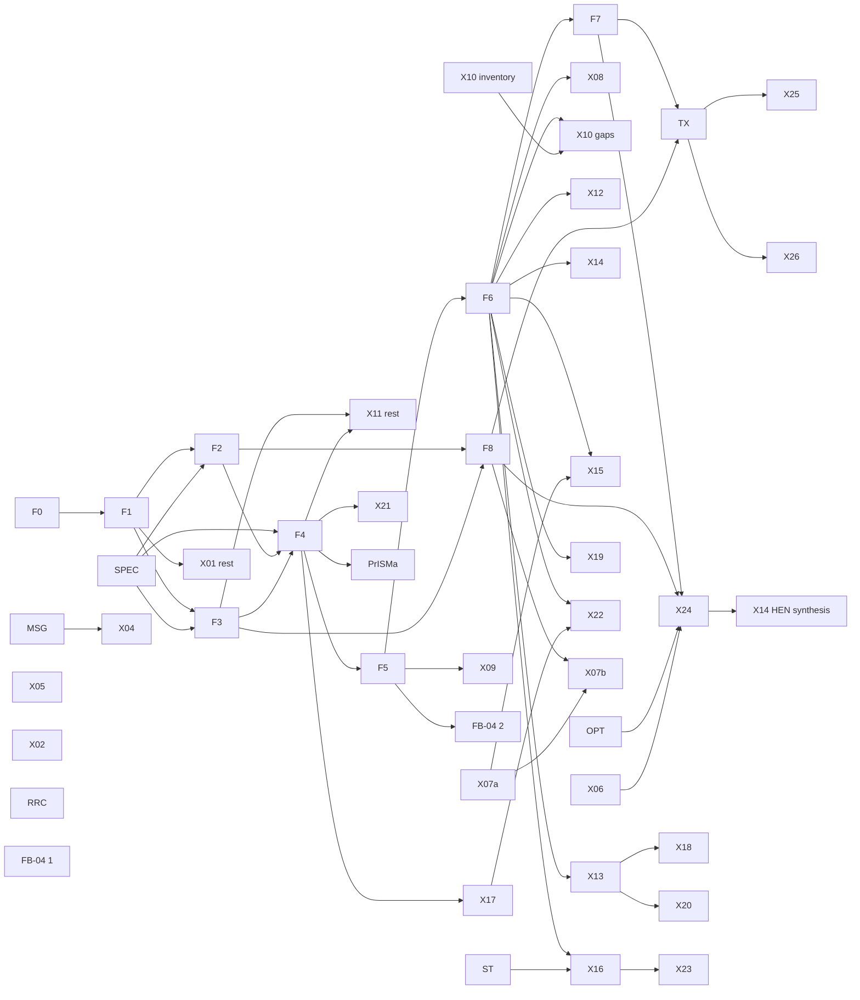

# Target architecture for the full simulator (roadmap stage 2)

Status: design note, design lane (`architect`), 2026-11-01. It is proposed. It has not yet been reviewed (stage 4) or
decided by Frank (stage 5). It is to be committed as ADR 0057 together with `docs/roadmap/roadmap.md`.

**Inputs:** the brief (`docs/roadmap/brief-architect-1-target-architecture.md`); `docs/roadmap/00-core-inventory.md`,
cited as "inventory §n"; ADR 0056 with Amendments 1–2; and decisions R-923 to R-927.

**Spot reads:** blueprint D01–D20; ADR 0002 D2, D4 and D7; ADR 0005 D1–D8; ADR 0016 D1 and D5–D8; ADR 0050 D1–D10; the
`ProcessRevision` schema; `models/__init__.py:95-135`.

This note decides structure and order. It does not choose correlations or parameter sets, and it does not specify any
package in detail. Each package still gets its own design pass, ADR and review (plan §1.3, ADR 0056). Nothing in brief
§5 is reopened.

---

## 1. Summary

**Problem.** Up to 0.3, five core structures were fixed for the cases each release needed: the stream state `nTP-v1`;
two-slot phase handling, spread over five phase vocabularies; one provider per revision, selected by a record-file path;
unit families that encode their own provider's physics (ADR 0050 D3); and steady-only problems. Every capability in
scope breaks at least one of them. The design replaces each structure once. It keeps every released number, and it never
rewrites a legacy path.

**Decisions** (argued in §2).

1. **Two-level material model.** Providers see an *evaluation state*: T, P, amounts and optional attributes.
   `StreamState` is its attribute-free case. Flowsheets see registered, versioned *connection state definitions*, built
   from substreams, attributes and a thermal coordinate. `nTP-v1` is one such definition, byte for byte as today.
2. **Non-equilibrium material is a substream; equilibrium material is a phase.** Every carried attribute is an extensive
   flow. Generic units can therefore transport any attribute without attribute-specific code.
3. **State points with phase sets.** Every phase set lies on the Boolean lattice of the point's candidate phases. With
   two candidates this is exactly ADR 0005's lattice, so all of ADR 0005 carries over. Declared phases become
   assertions, which gives regime discovery (FB-04 (2)). This is D09 as written.
4. **Property layer by composition.** A registered method, a content-addressed data lock and optional add-on sources
   compose into a frozen-protocol provider (D08). There is one enthalpy convention per flowsheet. Methods are assigned
   per unit, with a flowsheet default.
5. **Units are written against a thermo face, never against a provider.** Admission is computed from declared
   capabilities. A coverage matrix generated in CI stops the X10 gaps from recurring. Legacy families are frozen; new
   capability goes into a generic `std.*` family.
6. **One problem stack.** `ProblemSpec` and the frozen `CompiledProblem` are unchanged. Three layers sit on top: a
   `DynamicSpec` (a differential map to conserved holdups, time inputs and events), functional programs, and run kinds.
   D01, D02 and D03 hold. The integrator's step loop is owned. MINLP is solved by logic-based outer approximation (LOA)
   over certified fixed-structure revisions.
7. **One contract.** A capability is a set of OPERATIONS rows, registry descriptors and catalogued messages. Units are
   converted only at the boundary. Long jobs report progress, write partial artifacts and keep checkpoints.
8. **Identity.** Revisions in schema v2 pin record hashes. Bundles carry the data lock, and embed records only where
   rights permit. No network is used inside a solve. The reproducibility classes (R-classes) extend to co-simulation and
   to adaptive solvers, which keep decision records.
9. **Front ends.** `ProcessRevision` is the only process truth. Layout and P&ID are separate linked documents. Every
   edit is a ChangeSet.
10. **One new revision schema version.** `ProcessRevision` v2 carries the whole foundation wave. Time inputs, recipes
    and superstructures are separate documents that reference a revision.
11. **Bit-identity by construction.** Legacy paths are never rewritten. One corpus gate (F0) proves it for every
    foundation.

**Foundations:** F0 corpus identity gate; F1 extension registry and computed admission (the core of X01); F2 material
model and `ProcessRevision` v2; F3 component data core (the core of X11); F4 property methods and thermo face; F5
phase-equilibrium framework, including FB-04 (2); F6 unit-model framework v2; F7 problem IR v2 and run kinds; F8
identity, replay and evidence v2.

**Sequence** (provisional, see §5).

| Line | Packages |
| --- | --- |
| 0.4 | MSG, ST, X04, X05, X02, OPT, FB-04 (1), X10 inventory, RRC, F0, the specifier pass, design wave W1 |
| 0.5 | X07a, F1/X01, F3, F2, F8, X06 |
| 0.6 | F4, F5, F6, X10 gaps, X09, X08, X17, X11 rest, PrISMa; Seider VCM at the end |
| 0.7 | F7, TX, X13, X07b |
| 0.8 | X12, X14, X16, X15, X22, X21 |
| 0.9 | X25, X26, X24, X18 |
| 1.0 | X19, X20, X23 |

---

## 2. Target architecture per area

"F0 PASS" means that the corpus gate of §3 passes at the old configuration.

### 2.1 Material model

**Today** (inventory §1, §2a). `StreamState(n, temperature, pressure)`, with `n` in the provider's component order; ids
`<S>.n.<C>`, `<S>.T`, `<S>.P`, plus `<S>.sat.V`/`<S>.sat.L` for saturated pure fluids; connections pin
`state_definition: const "nTP-v1"`; one `ComponentBasis` per revision; five phase vocabularies; the provider-level state
is the connection state.

**Needed.** More than two fluid phases. States that `(n,T,P)` does not fix: Gibbs' rule leaves the split open when `C −
π + 2 < 2` (a pure fluid at saturation, a binary at VLLE), and the `sat` patch does not generalise. Solids with particle
size distributions (PSDs); true and apparent species; generated pseudo-components; polymer amount bases and moments; a
general attribute mechanism.

**Design.**

1. **Two levels.**
   - The *evaluation state* is the provider level: `T`, `P`, amounts over a component list, optional attributes and the
     phase id evaluated. `StreamState` stays the type legacy providers accept. It is the attribute-free instance, and
     `EvaluationState.from_stream_state` loses nothing.
   - The *connection state definition* is the flowsheet level: a registered, versioned, canonical document. Its SHA-256
     is its identity.

   ```
   {id, version,
    substreams: [{id, kind: mixed|solid|nonconventional, components: [...],
                  species_basis: apparent|true, amount_basis: {<component>: mol|segment_mol|kg},
                  attributes: [{id, kind, scope: component|substream, index_set, grid_ref?}]}],
    thermal_coordinate: T|h,  pressure: P}
   ```

   `nTP-v1` is the registered definition with one `mixed` substream over the revision's components, all in `mol`, no
   attributes, and thermal coordinate `T`. Specifier Q1 fixes the general definition for new flowsheets.
2. **Substreams.** `mixed` is the equilibrium substream; its phase set may include equilibrium solids (Q8). `solid`
   carries kinetically separate solids and their attributes. `nonconventional` carries components without a molar mass,
   on basis `kg`, with constituent attributes. A stream has one thermal coordinate and one `P`. A per-substream T would
   be a later definition; no planned package needs it.
3. **Attributes.** Each attribute kind is registered (F1) with its index set (components, grid classes, segments or
   moments), its physical kind and its scale rule (D06).

   **Invariant:** an attribute is carried as an extensive flow. It is additive on mixing, proportional on splitting, and
   undefined when its parent flow is exactly zero (the analogue of ADR 0001 D3.1). Intensive values, such as a mean size
   or λ1/λ0, are derived and never carried.

   A PSD grid is declared once per substream, in the revision's `materials` section.
4. **Species, pseudo-components and polymers.** `species_basis` is set per substream; the map between apparent and true
   species is the method's stoichiometric matrix (elements and charge), and Q3 decides which basis connections carry.
   Pseudo-components are ordinary components whose records are *generated* (F3 provenance, with the assay and method
   hashes); no state change is needed. Polymers get a per-component amount basis (Q7) and per-component attribute
   vectors (segment flows, moment flows).
5. **One phase-id grammar** in new code: `VAPOR`, `LIQUID` (the first liquid), `LIQUID.2`, …, `SOLID.<id>`. Ordering is
   Q4. Legacy literals render unchanged: `TWO_PHASE` is `{VAPOR, LIQUID}` at a two-candidate point. `ZERO_FLOW` stays a
   stream property.
6. **Id grammar.** `nTP-v1` ids are unchanged. New tokens use only characters outside the id alphabet `[A-Za-z0-9_.:-]`,
   which the schema enforces on every revision-path id, so new ids cannot collide with existing ones: `/` for hierarchy,
   `@` for substream, `#` for state point or phase, `[ ]` for an index (for example `<S>@solid.n.<C>`,
   `<S>@solid.a.psd[7]`, `<P>#LIQUID.2.n.<C>`; F2 fixes the spelling). Ids stay opaque (R-019: no layer parses ids);
   structure travels in a *material layout* record.
7. **Solution state and identity.** `solution-state-v2` adds the material layout: per stream its definition id and SHA;
   the map from `(substream, component | attribute index)` to variable index; and the phase-set signature of each state
   point. Legacy runs still write `solution-state-v1`, unchanged. The definition SHA joins the numerical-model
   fingerprint (ADR 0002 D4.4, ADR 0007); variable ids carry the structure into `model_version` (ADR 0002 D2).

**Rejected.**
- *Widening `nTP-v1` in place.* Every state document, cache key and structure digest would move.
- *A phase-resolved connection state.* The variable set would follow the regime, so a phase change would alter
  `model_version` in mid-solve, against ADR 0005 D2.
- *One universal state carrying every optional block.* Every stream would pay for every feature.
- *Intensive attributes.* Every mixer and splitter would become attribute-specific, which is the X10 failure again.

**Foundation:** F2. **ADR:** ADR-F2. It amends ADR 0001 D2 and the types in `interfaces-frozen.md` §1, and it adds
`ProcessRevision` v2 (ADR 0002 D7: a new version, no instance migrated).

**Migration proof.** F0 PASS; v1 documents are read by the untouched v1 reader; `StreamState ↔ EvaluationState` is
bitwise for every corpus stream; the cache-key digests of the recorded sample are unchanged.

### 2.2 Phase-equilibrium framework

**Today** (inventory §1b–c, §5d). `FlashResult` has two slots, and `"TP"` is the only flash specification. ADR 0005
gives one regime per phase-selecting unit on the lattice `LIQUID — TWO_PHASE — VAPOR`: the set is frozen within an
attempt, the screen rejects a trial and never selects, restarts go by adjacency. Pure fluids use declared regimes (ADR
0051 D1), refused with `phase_regime_mismatch` on a mismatch. FB-04 is refused whichever regime is declared.

**Needed.** LL, VLL and solid phases; stability tests; phase sets discovered rather than declared; internal states with
their own phase sets (the isentropic reference); event indicators for dynamics; chemical equilibrium later (X13, X18).

**Design.**

1. **State points.** A unit asks the thermo face (§2.3) for every state it needs as a named state point: inputs (amounts
   plus two specifications from `{T, P, h, s, v, β}`), a method, candidate phases (the method's phase models intersected
   with an optional declared set), a formulation and outputs. The unit gets per-phase symbols for every candidate.
   Amounts of inactive phases are exactly `+0.0`.
2. **Signatures.** The signature of a point is its active set in canonical order. The signature of an attempt is the
   tuple of point signatures in plan order, which generalises `SolvePlan.signature_units`. R0 records the rendering, and
   a two-candidate point renders as it does today.
3. **Lattice and contract.** The phase sets form a Boolean lattice over the candidates. Two attempt signatures are
   *adjacent* when every point differs by at most one phase and at least one point differs; with two candidates this is
   ADR 0005 D2 exactly. ADR 0005 D2–D7 carry over with "regime" read as "phase set": frozen within an attempt; the
   screen rejects and never selects; restart by adjacency; disappearance on `BOUND_BLOCKED` at a watched phase amount;
   one decision function; checkpoint checks; root provenance. The contract is a new `SolvePolicy.phase_contract` value;
   `T03-phase-contract-v1` and `T05b-phase-contract-v2` remain, and no existing policy is rewritten.
4. **Formulations**, chosen per point by policy. *Procedural* (default): a batched opaque `PropertyBlock` (ADR 0003)
   solves equilibrium *at the frozen set* (locally smooth, implicit-function Jacobian), and a tangent-plane-distance
   (TPD) screen reports the unrestricted set; the block never changes its set within an attempt. *Lifted*: phase
   variables and rows go into the EO region, inactive phases pinned and restricted by id (ADR 0005 D5). *Smooth*: a
   reserved slot for D09's "one validated smooth EO formulation … later".
5. **Opening set (regime discovery, FB-04 (2)).** An unrestricted flash (stability plus split) at the initializer's
   state gives the opening signature. In a v2 document, a declared `phase_capability` is an *assertion*: it is checked
   at closure, where `phase_regime_mismatch` stays, and by the certificate. v1 documents keep ADR 0051 D1.
6. **Flash service.** `flash(EvaluationState, spec, candidates) → FlashResult(phases: tuple[PhaseOutlet, …])`;
   `stability(state, active_set) → StabilityReport` (the `tm` of each trial and the composition of an unstable trial);
   specifications TP, PH, PS, TV, Pβ and Tβ. Near-threshold `tm` decisions are flagged under ADR 0007 D2.4, so
   cross-platform R0 differences can be attributed.
7. **Event indicators (for TX).** The minimal `tm` of each inactive candidate, and the amount of each active phase. Both
   are continuous across phase boundaries.
8. **Conserved-basis slot.** Components by default, or an element-and-charge matrix. It is in the interface from day
   one. X13 (Gibbs reactor) implements it, and X18 (speciation) reuses it.
9. **Verifier.** At the converged set it re-checks the equilibrium residuals, non-negative phase amounts, and stability
   with the limitation fixed by Q5.

**Relation to D09 and ADR 0005.** This realises D09: a guarded procedural flash with explicit active-phase management
first, smooth EO later, and critical regions as typed limitations. It generalises ADR 0005 and does not replace it.

**Rejected.**
- *Declaring phases more carefully* (R-839). This fails the students it is meant to serve (FB-04).
- *Smooth complementarity as the default.* It needs validation per system (D09), and it weakens Newton and the verifier.
- *A block that selects its own phase set.* The residual would change mid-attempt, against ADR 0005 D3.

**Foundation:** F5. **ADR:** ADR-F5. It amends ADR 0005 and, for v2 documents, ADR 0051 D1 and ADR 0012; it adds a
`SolvePolicy` enum value and reshapes `SolutionCertificate.phase_branch`.

**Migration proof.** F0 PASS, and *decision equivalence*: every corpus case solved under v1 is re-run under the new
value with two-candidate points, and the attempt and event sequence, the signatures and the floats are bitwise
identical; only the policy hash differs.

### 2.3 Property and data layer

**Today** (inventory §2, §3). `PropertyProvider` is frozen; providers are built by id. A revision selects one provider
through `record_source`, a path that `content_hash` excludes (ADR 0002 D4.2). Records are YAML, one file per benchmark
directory. There is no registry; the verifier keeps its own `FRESH_PROVIDERS` table. `pr-lib-v1` is library-only, and
CoolProp allows one fluid per basis.

**Needed.** X01 registration, X11 records, X17 transport properties, X15 CAPE-OPEN thermo; a mixture model composed with
a pure-component data source; several property methods in one flowsheet; references that work for reactions on any
basis.

**Design.**

1. **Records (F3).** `ComponentRecord` v2 carries identity keys (InChIKey, CAS, formula, names, user ids), `charge`,
   per-property entries (a value or a correlation: registered form id, coefficients, units, validity range), `kind` ∈
   {measured, fitted, estimated, generated, synthetic}, uncertainty, provenance (adapter, source and version,
   transformations) and rights (R-706). Identity is the SHA-256 of the canonical record minus retrieval-volatile
   metadata (Q9). Records live in a content-addressed project store on files, written by atomic rename with portable
   locks only.
2. **Data lock.** The canonical document `{components: [(id, record_sha)], parameter_sets: [sha], method_options}`. Its
   SHA is the composed provider's `data_sha256`.
3. **Composition.** A property method is an F1 factory whose descriptor gives the model family, required record fields,
   phase models, vocabulary with derivative orders, convention capability and domain rules. `compose(method, data_lock,
   add_on_sources)` returns a provider implementing the frozen protocol, with types widened by F2.
   `implementation_sha256` is the self-hash of the method's modules (ADR 0008 A2, X4′); cache keys keep their form
   (inventory §3e).
4. **Source stack.** Each vocabulary item routes to exactly one source: the thermo method, a transport add-on (X17), a
   CAPE-OPEN package (X15) or an external library. A conflict needs an explicit assignment; nothing is overridden
   silently.
5. **Vocabulary registry.** Each item has a name, an index set, a dimension, flags for phase-specific and
   reference-dependent, and derivative semantics (for example `∂/∂n_c` at fixed T and P). Legacy names (`h`, `lnK`,
   `lnphi_<c>`) map to items through legacy-provider adapters. The five existing providers therefore become property
   sources unchanged.
6. **Enthalpy convention.** One per flowsheet (Q2). The default is the elemental formation reference. Each method is
   shifted by an amount computed from its records. A method that cannot be shifted is single-method only.
7. **Method assignment (v2).** A revision default with per-instance overrides. A unit evaluates all its ports with one
   method. A material connection between methods is admitted when their conventions agree, since the stream state does
   not depend on the method. The energy summary gives a subtotal per method.
8. **Thermo face.** `MaterialModel.state_point(...)` is the only path from a unit to properties. State points are
   batched per method (one vectorised callback per method, block-diagonal Jacobian pattern); exact caching is per point.

   ```
   state_point(point_id, inputs: StateInputs, spec: (name, name), method: MethodKey,
               phases: PhasePolicy(candidates, mode=equilibrium|fixed|frozen_from_inlet),
               outputs: OutputRequest(per_phase=[amount, composition, items...], mixture=[items...]),
               formulation: procedural|lifted|smooth) -> StatePointSymbols
   ```

9. **Verifier.** For a v2 run it recomposes from the data lock afresh: fresh objects, no shared cache. `FRESH_PROVIDERS`
   is unchanged.
10. **CAPE-OPEN thermo.** A source of kind `capeopen`. It runs over Windows COM through X07a's platform layer and is
    refused with `platform_unsupported` elsewhere. Its derivatives are declared, finite differences included.

**Rejected.**
- *Today's one provider per record file.* This is the failure behind X10 and FB-07.
- *A global mutable provider.* Plan §2.1 forbids it.
- *Records referenced by path.* A path is not an identity: two revisions with different data share a `content_hash` (ADR
  0002 D4.4).

**Foundations:** F3 and F4, built on F1. **ADRs:** ADR-F3 (`ComponentRecord` v2; amends ADR 0050 D1 for v2 documents)
and ADR-F4 (vocabulary, composition, convention, assignment, thermo face; amends ADR 0050 D5, and ADR 0011's reaction
datum where Q2 touches it).

**Migration proof.** F0 PASS, and *re-composition identity*: methods composed from imported records reproduce, bitwise
on recorded request sets, the `describe()` values and outputs of `pr-c1-v1`, `wilson-ig-v2`, `iapws95-v1` and
`coolprop-heos-v1`. Identity hashes differ by design; legacy runs keep the legacy providers.

### 2.4 Unit-model framework

**Today** (inventory §4). `UnitModel` has `ports`, `declared_equations`, `manifest`, `contribute(wiring, components)`
and `evaluate`; rows are `EquationSpec`s against `Algebra`, properties come through `PropertyBlock`s. The application
layer holds the identity tables `MODEL_BUILDERS`, `MODEL_BASES` and `MODEL_SIGNATURES`. Each family encodes its own
provider's physics (ADR 0050 D3). Sizing is an E01 functional; external models are variants (ADR 0033/0034).

**Needed.** Any basis; steady and dynamic modes; user-defined units; rate-based stages; external, co-simulated and
CAPE-OPEN units; sizing and costing hooks; hierarchy.

**Design.**

1. **`UnitModel` v2.** Methods `declare(binding) → UnitDeclaration` and `contribute(wiring, material: MaterialModel,
   mode) → Contribution`, plus optional `evaluate` (causal, for sequential-modular use and initialization) and
   `initialize`. `UnitDeclaration` covers ports (each with the state definitions and substreams it accepts), parameters
   with kinds, modes ⊆ {steady, dynamic}, state points, required capabilities (vocabulary items × phase kinds ×
   derivative order, flash specifications, phase models), derivative declarations, the initializer id, equipment items,
   and statefulness for external units. `Contribution` carries rows (with ADR 0008 D3 accumulation), owned variables
   with kinds, the requested state points, and in dynamic mode only the holdups, differential pairs and event
   functionals.
2. **Admission (F1).** Requirements are matched against method descriptors and state definitions. A failed match is
   refused with `capability_missing(<unit>, <method>, <capability>)`. Legacy families keep the frozen `MODEL_BASES`.
3. **Coverage matrix in CI** (what stops the X10 gaps from returning). Every admitted (unit, method) pair runs a
   generated feed → unit → sink case and must reach `VERIFIED`; every refused pair must name its missing capability; an
   untyped refusal, or an admitted pair without a test, fails CI. A new method enters the matrix automatically.
4. **Generic family `std.*`**, written only against `MaterialModel`; an architecture test forbids imports of provider
   modules. The legacy families `syn001.*`, `c1.*` and `thermal.*` are frozen for structure (bug fixes and FB-04 (1)
   remain allowed), and existing revisions keep their model ids. An opt-in tool proposes a `std.*` mapping for a v1
   revision, checked by an equivalence test; it is never applied silently.
5. **Modes** (ADR 0008 X4′). The dynamic variant is a separate manifest that shares kernels with the steady one. F6
   builds steady variants. The dynamic mode is declared, and refused with `mode_unsupported(dynamic)` until TX.
6. **Hierarchy.** An instance may reference a flowsheet template, which is a sub-revision referenced by hash, with
   exposed ports. Templates are flattened at bind time under `/`-prefixed ids. They serve columns, superstructure
   alternatives and PFD blocks.
7. **Expression documents.** One restricted, canonical math grammar as a JSON AST: constants; symbols for variables,
   parameters and vocabulary items at state points; `+ − × ÷`, `pow`, `exp`, `log`, `sqrt`; piecewise forms only through
   declared regimes (E01 D3). Compiled by the same compiler and hashed into `content_hash`; agents can author it and no
   code runs. Uses: declarative user units, user rate laws (X13), TX events and inputs, X25 recipe conditions, report
   quantities. Python plugin units remain admitted through F1 under the `install` right; E01 D5 is untouched for shipped
   cost forms.
8. **Adapters over v2.** External units (ADR 0033/0034): an opaque block with a declared derivative method.
   Co-simulation (R-923): stateful, dynamic only, exchanged in TX's step loop. CAPE-OPEN units: sequential-modular only,
   finite-difference derivatives declared for EO, Windows only.
9. **Rate-based stages** are ordinary units with several internal state points (bulk V, bulk L, interface). Their
   transfer rows use X17 vocabulary items and registered correlation forms. Stages are composed with templates.
10. **Sizing and costing hooks.** Equipment items name families from one taxonomy registry, shared by X12's sizing
    families, X16's icons, X23's DEXPI classes and the semantic roles. Sizing quantities are post-solve functionals (E01
    D1); a design specification enters the problem only as a specification.

**Rejected.**
- *A family per provider* (today). This produced X10.
- *Refactoring legacy families in place.* Their expression graphs, and with them every corpus `model_version`, would
  change, so no bit-identity proof would be possible.
- *A built-in two-phase assumption.* X08 breaks it.
- *Code-only user models.* They are neither agent-safe nor hashable.

**Foundation:** F6, built on F1, F4 and F5. **ADR:** ADR-F6. It covers `UnitModel` v2, `ModelManifest` v2, the
expression grammar and the legacy freeze, and it amends ADR 0050 D3 for new families.

**Migration proof.** F0 PASS (the legacy families are untouched), and *equivalence* of `std.*` and the legacy units on
every corpus case on the `syn001`, Wilson, IAPWS-95 and CoolProp bases: the same verdict, and every certificate quantity
within the K04 numerical policy (ADR 0007 D2).

### 2.5 Problem and solver architecture

**Today** (inventory §5, §10, §11). `ProblemSpec` compiles to a `CompiledProblem` (CasADi, ADR 0003) and an
`ExecutionPlan`; attempts use Newton, PTC, Anderson and homotopy, then the verifier. M03 and E01 use a parametric twin;
the NLP runs through ADR 0032. Accumulation declarations exist (ADR 0008 D3); time does not.

**Needed.** DAE integration (TX, co-simulation included), NLP, MINLP (X24) and batch recipes (X25).

**Design.**

1. **Unchanged base.** `ProblemSpec` and the frozen `CompiledProblem` stay as they are. Every other form is a layer that
   references them.
2. **`DynamicSpec`.** Differential pairs map each `holdup_balance` row to its *conserved* holdup variable (component
   amounts, internal energy). Time inputs are parameter ids with trajectory references, applied through the parametric
   twin. Each event is a functional program, a direction and an action id. The initial condition is the dynamic model's
   own steady state at t₀, or specified. Because the states are conserved holdups, `M` is a constant 0/1 selection (A4).
   `EvaluationContext` stays time-free (ADR 0008 D1). `CompiledProblemMetadata` gains a nullable `differential_map`.
3. **Index.** A structural check runs first: a matching on `∂g/∂z`. A system of index above 1 is refused with
   `dae_index_unsupported` until an index-reduction extension exists. R-924 admits typed refusals for what is not yet
   built.
4. **Integrator.** The step loop is owned (D01). The default is variable-order BDF over the compiled residual and
   Jacobian, with SuperLU (D03) and the existing Newton as corrector. Phase changes, recipe steps and relief openings
   are events, followed by consistent re-initialization; co-simulation exchanges values at communication points. IDAS
   (through CasADi) is admissible as a cross-check. Further detail belongs to TX.
5. **Functional programs** compile as functional `ProblemSpec`s (E01 D2), never inside `CompiledProblem`. They carry
   objectives, inequality constraints, events and report quantities.
6. **Optimisation** follows ADR 0032: twin, gray box and Ipopt, with the candidate re-solved and certified. The study is
   a separate document that references a revision. Its decisions are specifications with `role: decision`.
7. **Synthesis (X24).** A *superstructure document* holds a base revision, alternatives as ChangeSets, logic constraints
   and an objective functional. It is solved by an owned LOA: every NLP subproblem is a fixed-structure revision, solved
   and certified by the existing route, and the master MILP is built from outer-approximation cuts with a reused solver
   (default HiGHS, MIT; A2). Monolithic MINLP adapters may be admitted later with declared limitations. Optimality
   evidence reads "local per NLP; no global claim" (D13, D14).
8. **Batch (X25).** A *recipe document* becomes a sequence of segments over a dynamic flowsheet; each segment is an
   active specification set with an end event. A segment controller runs in TX's step loop. Scheduling, an MILP, is a
   later layer on top.
9. **Run-kind registry.** The kinds are simulation, optimization, transient, synthesis, batch, study and acquisition.
   Each declares its input documents, problem form, solver route, result type and R-class. The `ValidationReport` task
   enum widens, and each kind gets its own job operation.

**D02 and D03 hold.** CasADi covers algebraic and DAE residuals and Jacobians, and the Hessians the NLP needs; the
callback route covers external and CAPE-OPEN units. SuperLU stays the default: the DAE reuses factorizations within
modified Newton and assumes no symbolic reuse (D03). KLU-class adapters come later, driven by benchmarks and the D04
audit. No departure ADR is needed; scale is a measured risk (R1).

**Rejected.**
- *A second modelling language for dynamics.* Two compilers contradict D02.
- *IDAS as the only integrator.* It hides step decisions, so D20 replay fails, and phase-set events and co-simulation
  become awkward.
- *Big-M or hull MINLP as the primary route.* Dormant streams of undefined composition (ADR 0001 D3.1) would enter every
  relaxation. Their Jacobians are singular, and the subproblems cannot be certified.
- *Time in `EvaluationContext`* (ADR 0008 D1).

**Foundation:** F7, built on F6. **ADR:** ADR-F7. It amends ADR 0003 (the metadata field), makes ADR 0008 C7 and C8
concrete, and amends ADR 0019 and ADR 0020 (job operations, `ValidationReport` tasks).

**Migration proof.** F0 PASS. `differential_map` is absent for every steady problem, and it is not a member of ADR 0002
D2's structure document, so `model_version` is unchanged.

### 2.6 Application and agent contract

**Today** (inventory §8). `Application` is frozen (4 methods); `JobControl` has 7 and `Inspection` 9. One `OPERATIONS`
table feeds Python, the CLI, HTTP and MCP. There are 15 `ApiError` codes; input units follow ADR 0016; the web shell is
an HTTP client (ADR 0030).

**Design.** These rules are written into ADR 0057. Each is implemented by the package named in it.

| Rule | Owner | Content |
| --- | --- | --- |
| C1 One row per capability | — | A capability is a set of OPERATIONS rows: method, right, schemas, transports. No capability exists on one transport only. There are no private GUI endpoints. |
| C2 Discovery | F1 | `list_capabilities` returns descriptors with status, limitations, platforms and evidence class. `check_admission(unit, method, definition)` explains refusals. |
| C3 Messages | MSG | Every `ApiError` code, and every typed refusal or limitation code, has a catalogue entry: what, where (a template over element ids), why, what to do, and the failure kind (input, not supported, numerical or bug). Extensions register their entries through F1. CI fails on an emitted code that has no entry. `explain <code>` is an operation. |
| C4 Units | X04 | Conversion only in dispatch (inputs) and in projection (outputs). Internal values stay SI (ADR 0001 D1.1, ADR 0016 D1.2). Display preferences are per project or per request, outside identity. A gauge pressure needs a declared ambient pressure, set per project (R-924). |
| C5 Projections | ST, X16 | Derived after the solve from the verified state: through legacy providers until F4, through the thermo face after it. The artifact schema is per phase and per substream from the start. Projections never enter certificate identity. |
| C6 Long-running work | F7 | Progress events; partial artifacts (trajectory chunks, incumbents); checkpoints per run kind for resume (X06). Cancellation works as today. |
| C7 Branches | X06 | Named mutable references over the immutable revision DAG. Stored in the project store, never in documents. |
| C8 No code to author | — | Edits are ChangeSets, mathematics is expression documents, and data comes through acquisition jobs. |

**Constraints on the 0.4 packages,** so that none of them fixes a core structure: MSG's catalogue is keyed by code, uses
parameterised templates and is extensible; ST's artifact is ready for N phases and substreams; X04 works at the boundary
only; X02 extends the cache key additively (the warm-start member appears only when a warm start was used, so cold keys
are unchanged); OPT adds nothing to `ProcessRevision` beyond `role: decision` and consumes only `CompiledProblem` and
the twin.

**Rejected.** *A separate agent API* (splits the contract); *a GUI-only path* (splits the transaction semantics).

**Foundation:** none of its own; MSG, X04, ST and X06 carry this area, with F1 (C2) and F7 (C6). **ADRs:** each package
amends ADR 0019. **Migration proof:** existing request and response schemas are unchanged and their round-trip fixtures
pass; new codes are additive.

### 2.7 Identity, replay and evidence

**Today** (inventory §9). R-classes R0, R1, R2 (ADR 0007) and R3 for out-of-process runs (ADR 0034 D6); `RunManifest`;
bundles reference the backend by hash; `Environment`; three `ReplayMode`s; cross-platform comparison per ADR 0025.

**Design.**

1. **Data.** v2 revisions pin record SHAs inside `content_hash`. A bundle carries the data lock and embeds a record only
   when its rights permit redistribution (R-706, R-926); otherwise it references the record by SHA. A replay that lacks
   a record ends `NOT_RUN` with `data_unavailable(<sha>)`.
2. **No network inside a solve or a replay.** Acquisition is a job of its own (R3 provenance) that writes records.
   Solves read pinned records only.
3. **Extensions.** `Environment` gains a registry snapshot: the id, version and self-hash of every extension loaded.
4. **Platforms (X07).** R0 is identical on every registered platform; R1 and R2 agree within the K04 policy; a float
   that exceeds the policy gets a per-platform reference record (ADR 0025's pattern); near-threshold flags make an R0
   discrepancy attributable.
5. **Co-simulation (R-923)** is R3. Replay works from the record (step sequence, exchanged values, and the child's state
   snapshots when exportable); the certificate names what it could not re-check; the exact cache keys on the child's
   snapshot or is bypassed.
6. **Adaptive solvers (D20).** Decision records (step sizes, orders, event times, seeds, master iterations) are
   numerical records, not R0; integer control flow (event order, segment sequence, structures visited) is R0. A new
   mode, `forced_replay`, re-runs with the recorded decisions imposed, which separates float differences from decision
   differences. F8 designs it; TX builds it.
7. **Evidence classes.** Run reports state verification, validation (data kinds used, reference comparisons) and
   optimality separately. Estimated and generated data are flagged. Every descriptor carries implemented, tested,
   reviewed or released; agents never claim reviewed or released.

**Rejected.** *Embedding all data* (breaks R-706 and R-926); *fetching data at solve time* (non-deterministic, and
offline replay fails).

**Foundation:** F8. **ADR:** ADR-F8. It amends ADR 0007, ADR 0025 and ADR 0034 D6 (R3 generalised), and the schemas of
`RunManifest`, the replay manifest and `ReplayMode`. **Migration proof:** F0 PASS, including replay of the 0.3.0 bundles
with identical verdicts; legacy manifests are unchanged.

### 2.8 Front ends

**Today.** A no-build diagnostic web shell over HTTP (ADR 0030); no layout; DEXPI is a demand-driven adapter (D18).

**Design.**

1. **`ProcessRevision` is the only process truth.** GUI edits are ChangeSets through the same operations (C1).
2. **Layout documents:** a separate schema keyed by element ids (instances, connections, ports), versioned per revision
   lineage with its own hash, excluded from run identity, carried forward by id, with automatic layout for new elements
   and templates shown as nested blocks.
3. **Plant documents (P&ID, X23):** a separate engineering model with DEXPI-mapped classes (equipment, nozzles, lines,
   instruments) and trace links to process elements. Consistency checks are validation results. DEXPI import and export
   is an F1 exchange-format adapter; an import proposes a draft revision as a ChangeSet and never edits silently.
4. **Shared equipment taxonomy.** The taxonomy from F6 is shared by units, X12, X16 and X23.
5. **Reports (X16)** are deterministic renderings of artifacts with a renderer id. They are not evidence.

**Rejected.** *Layout inside `ProcessRevision`*: every drag would mint a new `content_hash`, and ADR 0002 D4.2's
exclusions would grow by schema change. *P&ID as the canonical model*: most of its elements have no simulation meaning.

**Foundation:** none of its own. ADR 0057 states the rules, X16 and X23 implement them, and F6 supplies the taxonomy and
the hierarchy.

---

## 3. Foundation packages

**Common entry criteria.** The design pass is done and the ADR Accepted. The specifier has answered the package's
questions (§6). Predecessor packages are merged, and F0 passes on `main`.

**Common exit criteria.** F0 passes at the old configuration; the new tests pass on every CI leg that exists at the
time; the manifest is `tested`; the reviewer pass is complete; every new refusal code has a catalogue entry (C3).

### F0 — Corpus identity gate (build lane; ADR 0057)

**Scope.** `scripts/corpus_identity.py --check` prints one line and writes a log file. It checks the registered corpus
(A1):

| Measure | What is compared |
| --- | --- |
| M1 | `content_hash` of each repository revision |
| M2 | `model_version` and `constants_sha256` of each compiled problem |
| M3 | `r0_sha256` of each registered run |
| M4 | `state_sha256`, bitwise, on the reference platform |
| M5 | Certificate verdicts and check results |
| M6 | Cache-key digests of a recorded request sample |
| M7 | Replay verdicts of the 0.3.0 bundles |
| M8 | Schema round-trips |

Where the release gate already has a bit-identity step for a measure, F0 wraps it and adds only what is missing (M2,
M6).

**Exit.** The gate passes on `main`. A one-ulp change to one registered parameter makes M2–M5 fail.

### F1 — Extension registry and computed admission (architect; ADR-F1; core of X01)

**Scope.** Kinds `property_method`, `property_source`, `unit_model`, `state_definition`, `attribute_kind`,
`data_source`, `record_generator`, `solver_route`, `run_kind`, `functional_contributor` (wrapping E01's
`register_contributor`), `exchange_format` and `message_entries`. A built-in table plus the entry-point group
`openflowsheet.extensions`. Each descriptor holds id, version, self-hash, requirements and provisions, status, typed
limitations, platforms, pip extra and data rights. Iteration is sorted by id, with a snapshot hash. The admission
function, `list_capabilities` and `check_admission`.

**Exit.** Every existing provider and unit is registered; admission over the legacy pairs equals `MODEL_BASES` exactly,
as sets; the snapshot hash is identical across runs and platforms (R0); the operations work on all four transports.

**X01 rest** (after F1): `pr-lib-v1` and `syn001.cascade` become selectable, and plugin authors get documentation.

### F2 — Material model and `ProcessRevision` v2 (specifier Q1, Q3, Q4, Q6–Q8, then architect; ADR-F2)

**Scope.** `EvaluationState` and the widened provider types (§8); the state-definition registry with `nTP-v1` in it;
substreams and attributes; the phase-id grammar and the phase-set signature type; the id grammar, the material layout
and `solution-state-v2`; and `ProcessRevision` v2 with `materials`, the `component_set` v2 slot (F3), the
`property_methods` slot (F4), optional phase assertions (F5), template instances and registered semantic-role ids (F6).
The v2 schema is frozen only after ADR-F3 to ADR-F6 are Accepted (W1, §5). Constructs whose foundation is not yet built
are refused with a typed code that has a catalogue entry.

**Exit.**
- `StreamState ↔ EvaluationState` is bitwise for every corpus stream.
- Every v1 `content_hash` is unchanged.
- The v2 fixtures round-trip.
- *Probes:* two test-only attribute kinds (`probe.moments` per component; `probe.classes` per substream, on a grid) and
  a two-substream definition pass through probe mixer and splitter units. The relative conservation residual is ≤ 1e-14
  for every attribute and component.
- The layout record rebuilds every `MaterialState` without parsing an id.

### F3 — Component data core (architect, with specifier Q7 and Q9; ADR-F3; core of X11)

**Scope.** The `ComponentRecord` v2 schema; identity-key resolution (an ambiguous key is refused with
`component_ambiguous(<key>)`); a content-addressed file store (atomic rename, portable locks, no `flock`); the data lock
and rights fields; an importer for the benchmark records and a user-file adapter; operations `search`, `get`, `register`
and `validate`.

**Exit.** Imported records equal, bitwise, the values from the YAML loaders (`pr_c1.load_records`,
`pr_lib.load_records`, the S10 records). The data-lock hash is stable across runs and platforms. The store tests pass on
the X07a legs; until those exist, on Linux, with the other platforms recorded as pending.

**X11 rest** (after F3 and F4): fetchers for NIST WebBook, PubChem and ThermoML; regression to correlations;
group-contribution estimation flagged as estimated; consistency checks as evidence; operations `fetch` and `fit`.

### F4 — Property methods and thermo face (architect, with specifier Q2; ADR-F4)

**Scope.** The vocabulary registry and legacy adapters; `compose` and the source stack; the convention shift; method
assignment and the method-boundary check; `MaterialModel` with procedural, batched state points; fresh composition in
the verifier.

**Exit.**
- *Re-composition identity:* bitwise (§2.3).
- *Convention shift:* Σν·h_shifted at 298.15 K (ideal gas) equals Σν·Δf h° from the records, within 1e-10 relative.
- Mismatched conventions are refused with `method_boundary_unsupported`.
- *Batching:* at N = 300 state points, the batched cost per point (values plus Jacobian) is ≤ 0.1 × the unbatched cost
  per point, both measured on the same machine.

### F5 — Phase-equilibrium framework (specifier Q4, Q5 and Q8, then architect; ADR-F5)

**Scope.** The N-phase flash with the specifications of §2.2, and stability analysis; the new contract value; regime
discovery (FB-04 (2)); event indicators; the conserved-basis slot; the verifier checks.

**Exit.**
- Decision equivalence (§2.2) holds over the corpus.
- On the specifier's registered LLE and VLLE systems, the phase compositions match an *independent* implementation or
  literature data within the registered tolerance. The default tolerance is 1e-8 absolute in mole fraction against an
  independent implementation.
- Stability is classified 100 % correctly on the registered stable and unstable feeds outside the near-threshold band.
- The FB-04 turbine solves with no declared phase. The result is `VERIFIED`, and the outlet `h` matches an independent
  IAPWS-95 evaluation within the registered tolerance.
- Each indicator's sign change brackets the boundary found by the flash within 1e-8 relative in T.

### F6 — Unit-model framework v2 (architect; ADR-F6)

**Scope.** The `UnitModel` v2 protocol and the `ModelManifest` v2 schema; a `std.*` seed (feed, sink, mixer, splitter,
heater, valve, flash, pump, compressor, turbine); the coverage-matrix generator; templates and flattening; the
expression grammar and its compiler; the equipment taxonomy; the seams for external, co-simulated and CAPE-OPEN units;
the architecture test.

**Exit.**
- Equivalence holds (§2.4); the matrix is complete (every pair verified or refused with a typed code).
- A two-level template flattens to stable ids; expression documents compile and are re-evaluated by the verifier; the
  dynamic mode is refused with a typed code.
- *Scaling:* for a `std` template column with 10–100 stages and 10 components, the log–log slope against stage count is
  ≤ 1.3 for both compile time and time per Newton iteration.

### F7 — Problem IR v2 and run kinds (architect; ADR-F7)

**Scope.** `DynamicSpec` and `differential_map`; the index check; functional programs for objectives, constraints and
events; the run-kind registry and the `ValidationReport` tasks; progress events; a chunked trajectory artifact; per-kind
checkpoints.

**Exit.**
- For a probe tank with holdup, the dynamic residual at ẋ = 0 equals the steady residual bitwise.
- An index-1 probe is accepted. An index-2 probe (fixed volume, incompressible liquid) is refused with
  `dae_index_unsupported`.
- Run kinds that are not yet built are refused with a typed code.
- Chunked artifacts round-trip, and each chunk's hash is verified.

### F8 — Identity, replay and evidence v2 (architect; ADR-F8)

**Scope.** The data lock in bundles, with rights-aware embedding; `data_unavailable`; the registry snapshot in
`Environment`; per-platform reference records (with X07a); evidence-class fields; the design of decision records and
`forced_replay` (TX builds both).

**Exit.** The 0.3.0 bundles replay with unchanged verdicts. A record that may not be redistributed travels by reference
only, and replaying it elsewhere ends `NOT_RUN` with `data_unavailable`. The registry snapshot is recorded and compared
on replay.

---

## 4. Dependency graph

"Requires" lists hard build prerequisites. Abbreviations: SPEC is the specifier pass (roadmap stage 3), OPT the
optimiser on revision flowsheets, RRC revision-region continuation.

| Package | Requires | Notes |
| --- | --- | --- |
| F0 | — | |
| SPEC | — | answers §6 |
| F1 | F0 | X01 core |
| F2 | F1, SPEC | schema frozen after ADR-F3…F6 are Accepted (design dependency) |
| F3 | F1, SPEC | X11 core |
| F4 | F2, F3, SPEC | |
| F5 | F4 | contains FB-04 (2) |
| F6 | F5 | needs F2 and F4 through F5 |
| F7 | F6 | |
| F8 | F2, F3 | decision records built with TX |
| MSG | — | fixed before X04 |
| ST | — | soft: X04 |
| X04 | MSG | |
| X05 | — | F8 builds on its environment record |
| X02 | — | additive cache key (§2.6) |
| OPT | — | E01, ADR 0032 |
| RRC | — | |
| FB-04 (1) | — | own specifier pass; local to the legacy turbine; superseded by `std.turbine` |
| FB-04 (2) | F5 | part of F5 |
| X10 inventory | — | measurement |
| X10 gaps | F6, X10 inventory | `std.*` and the coverage matrix |
| X01 rest | F1 | |
| X11 rest | F3, F4 | |
| X06 | — | resume of long jobs through F7 |
| X07a | — | CI legs; platform layer (paths, process spawn and kill, locks) |
| X07b | X07a, F8 | `nlp` and reactor environments on three OSes; per-platform references |
| X08 | F6 | decanter and extraction on `std.*` |
| X09 | F5 | PR liquid regime, pure-NH₃ flash |
| X12 | F6 | |
| X13 | F6 | implements the conserved-basis slot |
| X14 | F6 | the HEN-synthesis part requires X24 |
| X15 | X07a, F6 | |
| X16 | ST, F6 | |
| X17 | F4 | |
| X18 | X13 | element-constrained equilibrium from X13 |
| X19 | F6 | |
| X20 | X13 | |
| X21 | F4 | |
| X22 | X17, F6 | |
| X23 | X16 | DEXPI adapter via F1 |
| X24 | OPT, F7, F8, X06 | |
| X25 | TX | |
| X26 | TX | |
| TX | F7, F8 | co-simulation included |
| PrISMa | F4 | see A3 |



**The graph is acyclic.**
- No foundation depends on a feature package.
- The foundations order topologically as F0, SPEC, F1, F3, F2, F4, F5, F6, F7, F8.
- Every feature-to-feature edge lies on a chain with no back edge: MSG→X04; ST→X16→X23; X07a→X07b; X10i→X10g; X13→X18;
  X13→X20; X17→X22; OPT and X06→X24→X14h; TX→X25; TX→X26.

---

## 5. Provisional sequence into release lines

**Rules.**
1. Foundations are built in dependency order.
2. A foundation is *designed* before any package that could fix its structure is built. This is R-927's first failure
   mode.
3. A package that could falsify a foundation follows it soon after.
4. Each line closes with an acceptance case that exercises its foundations together.
5. ADR 0056's fixed placements stand:
   - MSG before X04;
   - the X11 core beside X01 in 0.5;
   - FB-04 (2) with the multiphase line;
   - Seider VCM at the end of 0.6.

**Design wave W1.** It produces documents only, runs during 0.4, and has at most two agents at a time.
1. SPEC answers §6.
2. Architect pass P1 covers F1 and F3.
3. Architect pass P2 covers F2, F4 and F5. They are coupled through the provider types and the state points, so one pass
   replaces three that would each re-derive the others.
4. Architect pass P3 covers F6, F7 and F8.
5. Each ADR set gets one reviewer pass.

`ProcessRevision` v2 is frozen at the end of W1.

| Line | Packages | Why | Line acceptance |
| --- | --- | --- | --- |
| 0.4 | ADR 0055 parts 1–3 (outside this note); **MSG**, ST, X04, X05, X02, OPT, FB-04 (1), X10 inventory, RRC, **F0**, SPEC, W1 | Boundary, packaging and local-unit work; under the §2.6 constraints none of it fixes a core structure. F0 and W1 must exist before any foundation is built | F0 green; ADR-F1 to ADR-F8 Accepted |
| 0.5 | **X07a**, **F1** + X01 rest, **F3**, **F2**, **F8**, X06 | From here on, every foundation is built on three OSes. F1 and F3 carry no thermodynamic premises. F2 freezes the grammar. F8 lands as soon as records enter revisions | A v2 revision with store-pinned records solves on the legacy route on all three OSes; 0.3.0 bundles replay everywhere |
| 0.6 | **F4**, **F5** (+ FB-04 (2)), **F6**, X10 gaps, X09, X08, X17, X11 rest, PrISMa | The multiphase core and the generic units. X08–X10 are the packages most likely to falsify F4–F6, so they follow at once | Seider VCM (Ch. 2, route 3) against Table 2.7; the FB-04 turbine with no declared phases; a VLLE decanter case; a complete coverage matrix |
| 0.7 | **F7**, **TX** (co-simulation included), X13, X07b | TX is the largest package, and it retires the risks in F5's events and F6's dynamic variants early. X13 runs in parallel as steady work and unlocks X18 and X20 | A dynamic flash drum with a phase-change event; a co-simulated unit (R3); a Gibbs reactor |
| 0.8 | X12, X14, X16, X15, X22, X21 | Low-risk extensions of F6, F4 and X17. X21 is the cheapest real material class, so it probes F3's generated records early | A costed flowsheet with a rigorous exchanger and a PFD; a rate-based absorber; an assay-based preheat train |
| 0.9 | X25, X26, X24 (+ X14 HEN), X18 | These need TX, OPT with F7, and X13 respectively | A batch recipe; a relief scenario; a small synthesis with certified subproblems; an electrolyte case |
| 1.0 | X19, X20, X23 | The most specialised units, and P&ID. Their state structure is designed in F2 and has been proved by probes since 0.5 | A solids train with a PSD; a polymerisation; a DEXPI round trip |

**Alternative not taken** (Frank's preference; O1). The design toolkit (0.8) could come before dynamics (0.7); the
dependencies allow either order. Dynamics comes first by default, because it tests F5 and F6 while they are still cheap
to amend.

---

## 6. Questions for the specifier (stage 3)

Only questions that shape a foundation are listed. Each has a default, so work can go on unattended.

1. **What is the general connection state definition, and its zero-flow rule?** Options:
   - (a) `nTP`, plus carried phase amounts where Gibbs' rule leaves the state undetermined;
   - (b) `(n, h, P)` with molar enthalpy;
   - (c) `(n, H, P)` with enthalpy flow.

   *Blocks* F2 (the coordinate and the variables), F4 and F5 (the state-point specifications).

   *Default:* (b).
   - At fixed `P` and `n`, `h` is strictly increasing in `T` for stable equilibrium, across phase transitions too, so
     the state is non-degenerate for every phase set.
   - `h` is carried as `T` is today, so it stays defined at zero flow. Option (c) loses `T` there.
   - A dormant stream's `h` follows ADR 0001 D3's convention for composition.
   - `nTP-v1` stays available.
2. **Which enthalpy reference applies to multi-method flowsheets and to reactions on any basis?** *Blocks* F4 (the shift
   and the boundary check). It also fixes F2's meaning of `h` if Q1 is answered (b).

   *Default:*
   - The elemental reference: elements in their standard states at 298.15 K and 1e5 Pa, with `h = Δf h°(ideal gas) +
     ideal-gas sensible part + departure`.
   - Each method is shifted using the formation enthalpies in its records.
   - A method without that data is used alone.
   - Energy summaries are given per method.
   - Legacy providers keep their own conventions.
3. **Which species basis do electrolytes use on connections?** *Blocks* F2 (the `species_basis` default), F4 (the
   true-species vocabulary items) and F5 (the conserved-basis slot).

   *Default:* apparent species on connections. True species come from the method's speciation, constrained by elements
   and charge. True-basis connections are admissible later, as a declared definition.
4. **How are several liquids and solids labelled?** The labels are R0 identity. *Blocks* F2 (the grammar) and F5 (the
   signatures).

   *Default:*
   - `LIQUID`, then `LIQUID.2` and on, ordered by a key component declared per flowsheet: the liquid richer in the key
     gets the higher index.
   - Without a key, liquids are ordered by descending mass density.
   - Labels are continuous within an attempt. Relabelling happens only at attempt boundaries, and is recorded.
   - `SOLID.<component>` is a pure solid; `SOLID.<model id>` is a solid solution.
5. **What is the stability test, and what may a certificate claim about it?** *Blocks* F5 (the screen, the
   near-threshold band and the verifier check).

   *Default:*
   - Michelsen TPD over a registered trial set:
     - Wilson-K trials, one vapour-like and one liquid-like;
     - a pure-component trial for each liquid candidate;
     - one trial for each solid candidate.
   - A phase is unstable if `min tm < −τ_tm`. The specifier registers `τ_tm` and the near-threshold band.
   - `phase_stability` reports pass, fail or unsupported, with the limitation "local search; global stability not
     established".
6. **Do the attribute semantics hold?**
   - Does the extensive-flow invariant suffice for PSDs, polymer segments and moments, and nonconventional constituents?
   - What is the zero-flow rule?
   - Is the PSD grid fixed per substream for each flowsheet?

   *Blocks* F2 (the attribute mechanism). *Default:* yes to all three. The zero-flow rule follows composition, and
   intensive values are derived.
7. **What is each component's amount basis** (`mol`, `segment_mol` or `kg`), and what do molar mass and molar `h` and
   `s` mean on each basis? *Blocks* F2, and F3 (the record schema).

   *Default:* `mol` for every existing component, `segment_mol` for polymers and `kg` for nonconventional components.
8. **Where do equilibrium solids end and solid substreams begin?** *Blocks* F2 and F5.

   *Default:* salts, ice and freeze-out are phase candidates of `mixed`. Kinetically controlled solids, such as crystals
   with a PSD, form a `solid` substream. Material moves between the two only through unit rows, such as crystallizer
   kinetics.
9. **What are the record kinds, how is a record identified, and what evidence does a run report?** *Blocks* F3.

   *Default:*
   - Identity is the canonical record without retrieval-volatile metadata (timestamps, request noise). It keeps the
     source id and version.
   - Every kind is admitted, and its kind is flagged.
   - Run reports list the data kind of each component property, in the validation class.
   - A data kind never changes a `VERIFIED` verdict (D14).

---

## 7. Risks, open questions and what would change the plan

| # | Item | Needs | Default meanwhile | Would change the plan |
| --- | --- | --- | --- | --- |
| R1 | CasADi compile and evaluation time at rate-based or dynamic scale (10⁴–10⁵ variables) is unknown (A7) | fact: the F6 scale benchmark | keep D02 | A slope above 1.3, or an unusable absolute time: an architect pass on the expression layer, recorded as an ADR; no silent switch |
| R2 | The attribute design may not fit the details of X19 or X20 | fact: their design passes | F2 probes; Q6 | Additive definition versions by ADR; a non-additive change needs a new decision (R-927) |
| R3 | Two unit code paths cost maintenance | preference | legacy frozen; opt-in proposals | Migration with a registered difference instead: an ADR per family, then re-registered evidence |
| R4 | If Q1 is answered (b), `T` is derived, which may confuse students | fact: specifier, MSG corpus | state points expose `T`; ST shows it | The specifier picks (a); F2 then carries phase amounts |
| R5 | Windows and macOS availability of the `nlp` stack (cyipopt, PyNumero), HiGHS wheels (A2) and CasADi plugins; CAPE-OPEN is Windows-only | fact: an X07a measurement | declared platform limitations (R-924) | OPT and X24 move behind X07b, or a pip-only NLP route is added by ADR |
| R6 | Plugins run in-process | preference | the `install` right; the snapshot is recorded | Sandboxing: an out-of-process host, with those runs in R3 |
| R7 | Rights of fetched or licensed data inside bundles | fact: R-706 rows per source | reference only, unless permitted | none structural |
| R8 | Foundation work delays visible features (0.5–0.6) | preference | R-927: design first | Only packages that fix no core structure may move earlier (the 0.4 set qualifies) |
| R9 | Near-threshold stability decisions may differ across platforms | fact: X07a legs | flags (ADR 0007 D2.4); per-platform records | A rate above the registered one: an F5 amendment of the screen |
| R10 | LOA may be slow for large superstructures | fact: X24 benchmarks | LOA; enumeration when small | Monolithic MINLP adapters as a declared second route |
| R11 | Index-2 DAEs are refused until index reduction exists | fact: a census of TX cases | typed refusal (R-924) | An index-reduction work order inside TX |
| O1 | Dynamics (0.7) before the design toolkit (0.8)? | preference | dynamics first | Swap the two lines; no dependency breaks |
| O2 | A bundled open databank | preference and fact (R-706) | nothing shipped until cleared; user-fetched data works | A cleared source gets a packaged path in X11 rest |
| O3 | PrISMa's scope beyond isotherms (A3) | fact: the PrISMa owner | 0.6 on F1 and F4, equilibrium only | Cyclic adsorption moves behind TX |
| O4 | X09's wider reactor box needs the owner's model behaviour | fact | PR liquid regime first | — |

**Assumptions.** These are stated, not verified.
- **A1.** The corpus can be enumerated from existing registries: the benchmark reference values, the W27 snapshot and
  the release gate's bit-identity steps.
- **A2.** `highspy` (MIT) has wheels for Linux, Windows and macOS.
- **A3.** PrISMa's first part needs only isotherm property models.
- **A4.** ADR 0008 A1.2's U–H relations fit conserved holdup states `(N_c, U)` with a constant `M`. A1.2 was not read in
  full.
- **A5.** `thermo/stability.py` (47 lines, not read) is not a full TPD implementation. If it is one, F5 reuses it.
- **A6.** No revision-path id contains `/ @ # [ ]`. The schema patterns guarantee this, and legacy non-revision paths
  are not rewritten.
- **A7.** CasADi's behaviour at scale is unknown (R1).

---

## 8. Frozen-interface changes

Every change is additive. Legacy documents and types stay valid, and their digests do not move. ADR 0002 D7.5 applies: a
reader never reads a newer document as an older one.

| Interface or schema (frozen by) | Change | ADR | Lands |
| --- | --- | --- | --- |
| `PropertyProvider` types (§2.1, `interfaces-frozen.md` §1) | `PropertyRequest.state` accepts `EvaluationState`, and `StreamState` stays valid. `Phase` follows the phase-id grammar. `PhaseSignature` takes phase-set renderings; legacy literals are unchanged. `FlashResult` gains `phases`, keeping `vapor` and `liquid`. `FlashRequest.specification` adds PH, PS, TV, Pβ and Tβ | ADR-F2 (types), ADR-F5 (semantics) | 0.5, 0.6 |
| `PropertyCapabilities` (P02/K01) | Adds `state_definitions`, `phase_models`, `vocabulary_version` and convention-shift capability | ADR-F2, ADR-F4 | 0.5, 0.6 |
| `ProcessRevision` (P01) | v2 adds `materials`, `component_set` v2 (records by SHA), `property_methods` with instance overrides, registered `state_definition` ids, optional phase assertions, template instances and registered semantic-role ids. v1 is unchanged | ADR-F2 (with F3–F6 inputs) | 0.5 |
| `ComponentRecord` (P01) | v2 adds identity keys, `charge`, correlation entries, `kind`, uncertainty, provenance and amount basis. v1 is read unchanged | ADR-F3 | 0.5 |
| `ModelManifest` (P01) | v2 adds modes, state points, required capabilities, equipment items and statefulness | ADR-F6 | 0.6 |
| `ValidationReport` (P01) | The task enum gains the run kinds | ADR-F7 | 0.7 |
| `CompiledProblemMetadata` (P02/K01) | A nullable `differential_map`. The `CompiledProblem` methods are unchanged | ADR-F7 | 0.7 |
| `EvaluationContext` (§2.1) | **Unchanged**: no time field (ADR 0008 D1) | — | — |
| `SolvePolicy` (K03) | A new `phase_contract` value | ADR-F5 | 0.6 |
| `SolutionCertificate` (K04/K05) | `phase_branch` shaped for N-phase state points; a `phase_stability` check id | ADR-F5 | 0.6 |
| `RunManifest`, replay manifest (K04/K05) | Data lock, registry snapshot, evidence-class fields; `ReplayMode` gains `forced_replay` | ADR-F8 (`forced_replay` with TX) | 0.5, 0.7 |
| Checkpoint metadata (K03); `SolveEvent` outcomes | Checkpoints per run kind; DAE and event outcomes | TX's ADR, on ADR-F7 | 0.7 |
| Job and job events (K06/T07) | Progress events, partial-artifact kinds, a job operation per run kind | ADR-F7; ADR 0019 and 0020 amendments | 0.7 |
| `Application` protocol (§2.1) | **Unchanged**: new capabilities are OPERATIONS rows and job operations (C1) | ADR 0019 amendments | per package |
| `OptimizationReport`, `Study` (M01–M04) | Synthesis report fields | X24's ADR | 0.9 |
| `UnitModel` protocol (not in §2.1) | v2 beside v1; v1 units run through an adapter | ADR-F6 | 0.6 |

ADR numbers are assigned when each ADR is written. ADR-F1 to ADR-F8 are expected to take 0058 onwards.
