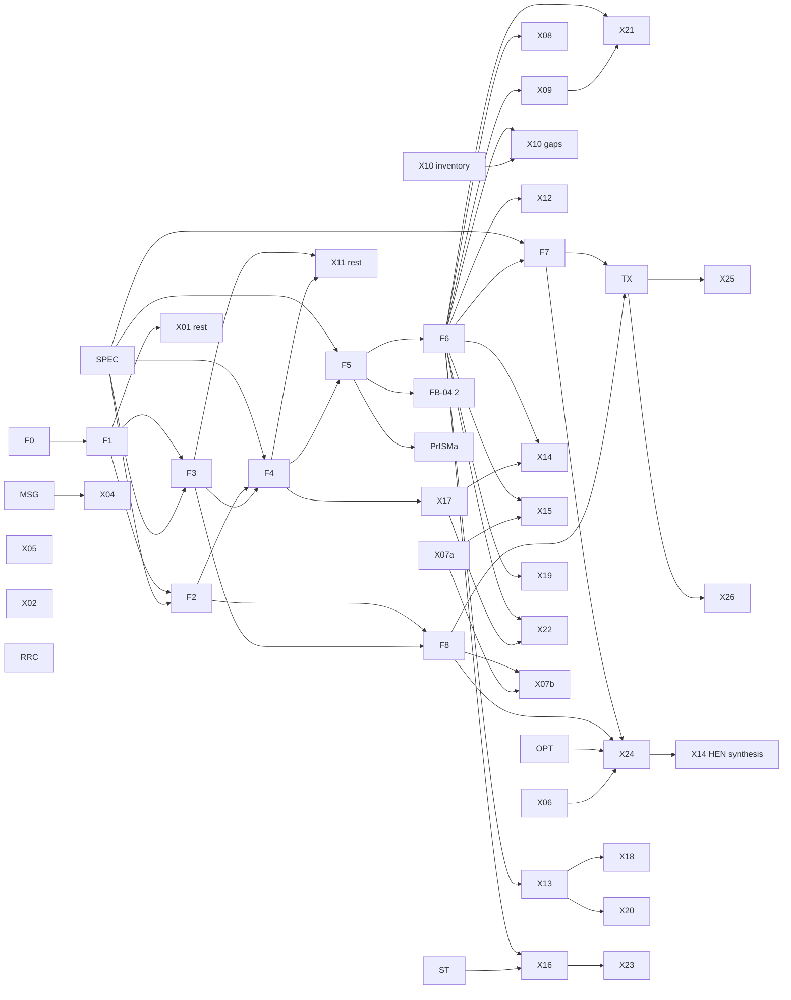

# Target architecture for the full simulator (roadmap stages 2 and 4c)

Status: design note, design lane (`architect`). Revision 1, 2026-11-01 (stage 2); Revision 2, 2026-11-02 (stage 4c,
this text). Proposed. Frank decides in stage 5. Recorded by ADR 0057 (Proposed) together with `docs/roadmap/roadmap.md`.

**Inputs.** Brief 1 (`brief-architect-1-target-architecture.md`), still binding for scope, constraints and what is out of
scope; brief 2 (`brief-architect-2-final.md`); the foundation rulings Q1–Q9 with Amendment 1 (`foundation-rulings.md`,
"the rulings"; clauses `Qn.Rk`, assertions `Qn.Ak`); the review (`review-roadmap.md`; findings M, S, N, U); the decisions
log (`decisions.md`); the inventory (`00-core-inventory.md`, "inventory §n"); ADR 0056 with Amendments 1–2.

**Spot reads for Revision 2.** `schemas/process-revision.schema.json:111-123` (port kinds; `nTP-v1` forced on every
connection); `schemas/specification.schema.json` (structured targets: object type, object id, path, component);
`compile/spec.py:169-235` (duplicate variable ids refused); `models/__init__.py:101-115` (id helpers; duty positive into
the unit); `models/syn001/heater.py:114-122` (an energy port that no connection can carry today);
`verify/table.py:965-985` (the exchanger's second-law checks are judged checks).

This note decides structure and order. It chooses no correlation or parameter set and specifies no package in detail.
Each package keeps its own design pass, ADR and review (plan §1.3, ADR 0056). The rulings are authoritative on scientific
semantics; where this note needs one changed, it says so and names the ADR that must decide (§6, §7).

## Revision 2 (2026-11-02)

| Id | Applied as | Where |
| --- | --- | --- |
| M1 | Three connection kinds, each with a registered definition: material, energy (`heat-v1`, `work-v1`), signal (`signal-v1⟨kind⟩`). Endpoint kinds `port`, `probe`, `parameter`. Controllers are units with signal ports. A core `reaction_sets` section. Utilities are units on energy connections; prices live in X12's economics document. A reserved `sections` mechanism (F1 kind `revision_section`) | §2.1.9–2.1.14, §2.4.11–12, F1, F2, §8 |
| M2 | F4: identity on the native, pre-shift layer, bitwise only for delegating compositions; R2 with a registered difference otherwise. F6: equivalence on a physical projection, in two steps | §2.3 proof, §2.4 proof, F4, F6 |
| S1 | Byte-level freeze of identity-bearing legacy modules; F0 measure M9 (per-file SHA); `.gitattributes` with `eol=lf` lands with F0; new self-hashes over LF-normalised bytes; a legacy bug fix is a registered numerics change | §2.4.4, F0, F1 |
| S2 | One thermal coordinate per flowsheet; legacy units only on `nTP-v1` flowsheets; a port-compatibility rule; specifications on derived quantities | §2.1.11–13, §2.3.8 |
| S5 | Phase families become a registered vocabulary; a `FLUID` family is proposed for single-fluid-model methods; specifier input to ADR-F5 | §2.2.2, §6, R12 |
| S6 | An injective v2 variable-id grammar with a separator outside the id alphabet at every user-id boundary; a [gen] round-trip test | §2.1.7, F2 |
| S7 | No scale, step bound or energy-check scale is taken from `|ĥ|` or `|Ḣ|`; an invariance assertion | §2.3.7, F4 |
| S8 | Ten state-structure sketches; the foundation changes they forced | §9 |
| S11 | ST keys phases by the structured triple and records the convention | §2.6 |
| N1 | A rank and conditioning check at consistent initialisation | §2.5.3, F7 |
| N2 | F0's sensitivity exit restated | F0 |
| N3 | The definition SHA joins the fingerprint for v2 runs only | §2.1.8 |
| N4 | X21 needs F5, F6 and X09; X09 is built on `std.*` | §4 |
| N9 | One F6 scaling point at about 1e4 variables | F6 |
| N11 | `check_admission` over a draft revision; descriptors carry schemas; id encoding; a `notice` failure kind | §2.6 |
| N12 | The F3 store on Windows | F3 |
| U1 | Adopted in part: the coordinate is visible only inside the material model; T definitions stay admitted (Q1.R5) and are limited to `nTP-v1` until another is needed | §2.1.11 |
| U2 | Adopted: the lifted formulation is deferred; its slot is kept | §2.2.4 |
| U3 | Adopted: one typed `submit_run(kind, documents)` | §2.5.9, §8 |
| U4 | Adopted: the v1 → `std.*` mapping tool is deferred | §2.4.4 |
| §3(b) | Byte-level freeze, defined equivalence, retirement rule | §2.4.4 |
| §3(c) | DASSL/IDA BDF with an IDAS cross-check gate; LOA with a reduced-space master, set-covering start and one enumerable superstructure | §2.5.4, §2.5.7 |
| §3 freeze | Core grammar frozen at the end of W1; the F4–F6 slots `preview` until the end of 0.6 | §2.1.14, §5 |

**Rulings edits** (rulings §12 and Amendment 1 §13):
- *Q1:* `h_mass` (R1); division-free rows (R2); derived T (R3); dormancy and labels (R4); T definitions (R5);
  reactivation (R6, S3); holdups (R7, N10). Exits: F2 Q1.A5; F4 and F5 Q1.A1–A4, A6, A7; F6 Q1.A9; F7 Q1.A10. §6 Q1 text
  corrected; §7 R4 decided.
- *Q2:* `ELEMENTAL-ref-v1` with anchor phase, entropy datum and component datum (R1–R7); anchor bridge (R8, N6). F4 exit:
  Q2.A2 replaces the 1e-10 clause. ADR-F4 also amends ADR 0001 D5.2.
- *Q3:* the conserved-basis object `{groups, A, R_ref}` with presets `apparent` and `true`, both from F2; group molar
  masses (R7, S9).
- *Q4:* the triple with an injective rendering; prefix rule and count lattice; exact order with flags afterwards (N7);
  water as the default first key.
- *Q5:* trial set, claim levels and witnesses; `near_critical` against `near_spinodal` (N8); inactive outputs (R7, S4);
  the appearance indicator ι_p (R8, S4). F5 exit: τ_tm = 1e-8, band [1e-9, 1e-7], last clause Q5.A9 (c).
- *Q6:* partition rule; zero-flow wording; grids; τ_mono (S10, no edit here). F2 exit: the third probe.
- *Q7:* amount basis from the record; distinct kinds; per-amount element matrix. *Q8:* exclusive role; dormancy per
  substream; confined adsorbed phases (R7, N5). *Q9:* provenance axes, record types, volatile set, rights register.
- *New findings A1-a and A1-b* are entry criteria of ADR-F2 and ADR-F4 (§3, §6), with proposed defaults.

**Decisions applied** (`decisions.md`): FB-04 (1) is dropped and solved by F5 and `std.turbine`; MSG stays in 0.4 ahead
of X04; the retirement rule; the freeze points; water as the first liquid key; mass-specific `ĥ`.

---

## 1. Summary

**Problem.** Up to 0.3, five core structures were fixed for the cases each release needed: the stream state `nTP-v1`;
two-slot phase handling spread over five vocabularies; one provider per revision, selected by a record-file path; unit
families that encode their own provider's physics (ADR 0050 D3); and steady-only problems. The revision schema has
energy and signal port kinds but no way to connect them. Every capability in scope breaks at least one of these. The
design replaces each structure once, keeps every released number, and never rewrites a legacy path.

**Decisions** (argued in §2).

1. **Two-level material model.** Providers see an *evaluation state* (T, P, amounts, optional attributes); `StreamState`
   is its attribute-free case. Flowsheets see registered, versioned *connection definitions*. The general material
   definition is `(n, ĥ, P)` with mass-specific `ĥ` (Q1). `nTP-v1` stays one registered definition, byte for byte.
2. **Three connection kinds.** Material, energy and signal connections each carry a registered definition. Controllers
   are units with signal ports; measurements are probes on any quantity; actuators drive declared parameters.
3. **Non-equilibrium material is a substream; equilibrium material is a phase** (Q8). Every carried attribute is an
   extensive flow (Q6), so generic units transport any attribute without attribute-specific code.
4. **State points with phase sets** on a count lattice that reduces to ADR 0005's lattice for two candidates (Q4). The
   attempt signature is a product of discrete coordinates (phase sets now; controller regimes and recipe segments
   later). Declared phases become assertions, which gives regime discovery (FB-04 (2)).
5. **Property layer by composition.** A method, a content-addressed data lock and add-on sources compose into a frozen-
   protocol provider. One convention per flowsheet, `ELEMENTAL-ref-v1` by default (Q2). Methods are assigned as a
   *method set* (one per substream) per unit side, with a flowsheet default.
6. **Units are written against a thermo face, never against a provider.** Admission is computed from declared
   capabilities, and a coverage matrix in CI stops the X10 gaps from recurring. Legacy families are byte-frozen, proved
   equivalent to `std.*` on a physical projection, and closed to new v2 work once `std.*` reaches parity.
7. **One problem stack.** `ProblemSpec` and the frozen `CompiledProblem` are unchanged. A `DynamicSpec` (conserved
   holdups, rate states, discrete states, events), functional programs and run kinds sit on top. The integrator follows
   DASSL/IDA in an owned step loop, cross-checked against IDAS. MINLP is solved by logic-based outer approximation
   (LOA) over certified fixed-structure revisions.
8. **One contract.** A capability is a set of OPERATIONS rows, registry descriptors and catalogued messages. Units of
   measure are converted only at the boundary. Long jobs report progress and keep checkpoints.
9. **Identity.** v2 revisions pin record hashes; bundles carry the data lock and embed records only where rights permit;
   no network inside a solve; co-simulation is R3; adaptive solvers keep decision records.
10. **One new revision schema version.** `ProcessRevision` v2 carries the whole foundation wave. Its core is frozen at
    the end of design wave W1; the slots F4–F6 fill stay `preview` until the end of 0.6. Time inputs, recipes, scenarios,
    superstructures, studies and economics are separate documents that reference a revision.
11. **Bit-identity by construction.** Legacy paths are never rewritten. One corpus gate (F0) proves it for every
    foundation, including a per-file check of the frozen modules.

**Foundations:** F0 corpus identity gate; F1 extension registry and computed admission (core of X01); F2 material model
and `ProcessRevision` v2; F3 component data core (core of X11); F4 property methods and thermo face; F5 phase-equilibrium
framework, with FB-04 (2); F6 unit-model framework v2; F7 problem IR v2 and run kinds; F8 identity, replay and evidence
v2. The provisional sequence into release lines is in §5 and, in plain words, in `docs/roadmap/roadmap.md`.

---

## 2. Target architecture per area

"F0 PASS" means that the corpus gate of §3 passes at the old configuration.

### 2.1 Material model

**Today** (inventory §1, §2a, §6a). `StreamState(n, temperature, pressure)`; ids `<S>.n.<C>`, `<S>.T`, `<S>.P`, plus
`<S>.sat.V`/`<S>.sat.L` for saturated pure fluids; every connection pins `state_definition: const "nTP-v1"` and
`component_mapping`, whatever its kind; units declare energy ports (a heater's duty) that stay unconnected, so the duty is
a unit variable `<U>.Q`; one `ComponentBasis` per revision; five phase vocabularies.

**Needed.** More than two fluid phases; states that `(n, T, P)` does not fix (Gibbs' rule leaves the split open when
π = C + 1); solids with PSDs; electrolyte bases; generated pseudo-components; polymer bases and moments; a general
attribute mechanism; energy and signal connections; reaction sets.

**Design.**

1. **Two levels, three connection kinds.** The *evaluation state* is the provider level: T, P, amounts over a component
   list, optional attributes, the phase evaluated. `StreamState` stays the type legacy providers accept;
   `EvaluationState.from_stream_state` loses nothing. A *connection definition* is the flowsheet level: a registered,
   versioned, canonical document whose SHA-256 is its identity.

   ```
   material: {id, version, connection_kind: material, thermal_coordinate: h_mass | T, pressure: P,
              substreams: [{id, kind: mixed | solid | nonconventional, components: [...],
                            conserved_basis: {preset: apparent | true} | {groups, A, R_ref},
                            attributes: [{kind, scope: component | substream, partition: bool, grid?}]}]}
   energy:   {id, version, connection_kind: energy, variables: [{field, quantity_kind}]}   # heat-v1 {Q}; work-v1 {W}
   signal:   {id, version, connection_kind: signal, variables: [{field: s, quantity_kind: <argument>}]}
   ```

   The general material definition is `(n, ĥ, P)` (Q1.R1): one amount per carried index (a component, a group (Q3) or a
   partition class (Q6)) on its component's record basis (Q7.R1); `ĥ = Ḣ/ṁ` in J/kg on the flowsheet convention, with
   `ṁ = Σ M n` (group masses M_g, Q3.R7); one `ĥ` and one `P` per stream. Rows are division-free (`ṁ ĥ − Ḣ = 0`, Q1.R2).
   T is derived from the PH state point under the producing unit's method and is never a connection variable (Q1.R3).
   `nTP-v1` is the material definition with one `mixed` substream over the revision's components, the `true` preset
   (A = I, R = ∅), no attributes and coordinate T.
2. **Dormancy and labels** (Q1.R4, Q6.R3, Q8.R6). A stream or substream is dormant iff every carried amount in it is
   exactly `+0.0`. Then `Ḣ`, `ṁ` and every extensive attribute are exactly `+0.0`; composition, T and derived intensives
   are null (`zero_flow`); `ĥ` is a label written by the unit's zero-flow form (`ĥ_out − ĥ_label = 0`, the first
   inlet's `ĥ` or `+0.0`). A label is never a property input or a reported result. A substream may be dormant in a
   flowing stream. Reactivation re-seeds `ĥ` at an attempt opening (Q1.R6; §2.2.5).
3. **Substreams** (Q8). `mixed` is the equilibrium substream; its candidates include equilibrium solids and confined
   adsorbed phases (`SOLID(<isotherm>)` with a sorbent confined to it, Q8.R7). `solid` carries kinetically separate
   solids and their attributes. `nonconventional` carries `kg`-basis components. A component's solid role is exclusive
   (Q8.R2); material moves between substreams only through unit rows (Q8.R3); substreams share `ĥ`, `P` and T (Q8.R5).
4. **Attributes** (Q6). Every carried attribute is an extensive flow: additive on mixing, proportional on non-classifying
   splitting. *Partition* attributes (PSD amounts per class, segment flows per type, NC constituents) are carried instead
   of their parent, which is their fixed-order sum; *non-partition* attributes (particle numbers, λ0, λ2, PSD moments) are
   carried beside it. F1 refuses a kind with a definitional identity (`attribute_redundant`). An attribute is exactly
   `+0.0` when its parent is exactly zero; a derived intensive is undefined iff its denominator is exactly zero. A grid is
   declared per substream in the definition and enters its SHA; mismatched grids are refused, and regridding is a unit.
   Kinds may declare admissibility inequalities with the allowance τ_mono = 1e-12 (Q6.R5).
5. **Species, pseudo-components, polymers.** Electrolytes use the conserved basis (A, R, z) of Q3, valid iff A R = 0
   and ker A ∩ ker zᵀ = span R; the object also carries the group masses M_g, computed once at composition (Q3.R7);
   true species are state-point outputs (Q3.R3). Pseudo-components are ordinary components
   with generated records (Q9.R5). Polymers use `segment_mol`, a segment-type partition for copolymers and the moments
   λ0, λ2; λ1 is the segment amount and is never carried as an attribute; M is per segment type (Q7.R2). `molar_flow`,
   `segment_molar_flow` and `mass_flow` are distinct kinds (Q7.R3).
6. **Phase ids** (Q4.R1). A phase id is the triple (family, qualifier, ordinal). Families form a registered vocabulary,
   with `VAPOR`, `LIQUID` and `SOLID` at F2 (S5 may add `FLUID`, §6). Rendering: `VAPOR`, `LIQUID`, `LIQUID.2`,
   `SOLID(<qualifier>)`, `SOLID(<qualifier>).2`. The qualifier sits between parentheses, which are outside the id
   alphabet, so the rendering is injective even for qualifiers like `a.2` (Q4.A5). Two-candidate points render `LIQUID`,
   `VAPOR`, `TWO_PHASE` as today (Q4.R7); `ZERO_FLOW` stays a stream property.
7. **Variable ids** (S6). User ids use the alphabet `[A-Za-z0-9_.:-]`, which the schema enforces. Every v2 id has the
   form

   ```
   vid := owner ("@" substream)? ("#" point ("#" phase)?)? "~" field ("[" index "]")*
   owner := uid ("/" uid)*          e.g. T1/S3@solid~n[CaCO3][7]   P2#flash#LIQUID.2~n[water]   S5~h   C7~Q
   ```

   Each separator (`/ @ # ~ [ ]`) is outside the alphabet; fields are keywords from a closed registered set; component,
   attribute and class indices sit in brackets; the order of the parts is fixed. Hence a test-only parser inverts the
   rendering, which proves injectivity (a function with a left inverse is injective). Every v2 id contains `~` and no
   legacy id can, so v2 ids never collide with `nTP-v1` ids, which stay exactly as today. Legacy ids are not injective in
   general (`a.n` with component `x` and `a` with component `n.x` both give `a.n.n.x`); `ProblemSpec` already refuses
   duplicate ids loudly (`compile/spec.py:174`), and that remains the backstop. Ids stay opaque in production (R-019);
   structure travels in the material layout.
8. **Solution state and identity.** `solution-state-v2` adds the material layout: per connection its definition id and
   SHA; the map from (substream, index tuple) to variable index; each state point's phase-set signature. Legacy runs
   write `solution-state-v1`, unchanged. For v2 runs only, the definition SHA joins the numerical-model fingerprint (ADR
   0002 D4.4, ADR 0007); legacy fingerprints do not move (N3).
9. **Energy and signal connections** (M1). An energy connection carries its definition's variable: `heat-v1` a heat
   flow Q, `work-v1` a shaft or electrical work rate W, both in W. Its value is the energy flow from `from` to `to`; an
   inlet energy port reads it as energy into the unit (ADR 0001 D4.1's duty convention), an outlet port as energy out. An
   unconnected energy port leaves the duty a unit variable, as today. A heat connection carries Q only. Its second-law
   direction is a judged verifier check, `heat_direction`, on the heat-exchange temperature intervals both endpoints
   declare (F6). Today's exchanger `hot_end`/`cold_end` checks work the same way. A signal carries one SI value of
   the quantity kind its definition names; both endpoints must agree (`signal_kind_mismatch`).
10. **Endpoints.** `{instance, port}` for any kind; `{probe: <target>}` as a signal source only, reading any
    specification target, derived quantities included (item 13); `{instance, parameter}` as a signal sink only, driving a
    parameter the manifest declares `manipulable`, which then becomes a variable. A parameter bound both by a signal and
    by a time input is refused (`parameter_binding_conflict`).
11. **One thermal coordinate per flowsheet** (S2(a)), visible only inside the material model (U1). Every material
    definition in a revision has the revision's `thermal_coordinate`:
    - an `h_mass` flowsheet admits `std.*` units only;
    - a `T` flowsheet admits `nTP-v1` (until another T definition is registered under Q1.R5), legacy units and `std.*`
      units, on the legacy provider's native convention (Q2.R5).

    `std.*` units see per-port symbols (T, Ḣ, phases) from the material model whichever coordinate is the variable. The
    T path refuses a degenerate point typed (`state_degenerate_in_definition`, Q1.R5). *Rejected:* converting at a
    definition boundary. T → `ĥ` is not single-valued where π = C + 1 (Q1 argument), and that is exactly the FB-04 case.
12. **Port compatibility** (S2(b)). A connection has one definition, and both endpoints must accept it. Generic transport
    units (mixer, splitter, heater, valve, pump, compressor, turbine) require one definition on all their material ports.
    The exception is a unit that declares *subset fill*: it admits inlets whose substreams, components and attributes are
    subsets of the outlet's, with identical grids and conserved bases, and the missing parts enter as exact `+0.0` (Q6.R3,
    Q8.R6). Ports of one unit with different definitions need a map that the unit declares (crystallizer, regridder,
    basis converter).
13. **Derived quantities** (S2(c)). A derived quantity is registered (F1 kind `derived_quantity`). Its registration gives
    its inputs, its auxiliary state points (with their specifications and conditions), an output expression over
    vocabulary items and attributes, a quantity kind, and a degeneracy condition. Built in: T, β, `s_mass`, `h_molar`,
    x[c], w[c], ρ, bubble and dew T and P. A specification, an OPT decision or a probe on one adds its state points
    (under the producing unit's method) and one row. Where its derivative in the stream's coordinate vanishes (T on a
    π = C + 1 plateau), it is refused at the opening (`specification_degenerate(<spec>)`), and the certificate's
    regularity check covers the converged state. MSG then suggests β or `ĥ`.
14. **`ProcessRevision` v2.** Freeze points: *core* at the end of W1; *preview* until the end of 0.6 (§5).

    ```
    schema_version: 2, revision_id, parent_revision, content_hash, title, description            core
    convention: ELEMENTAL-ref-v1 | <native convention id>                                        core
    component_set: {components: [{id, record_sha}], parameter_sets: [sha]}                       core
    materials: {thermal_coordinate, definitions: [...], grids: [...], phase_order_keys?}         core
    reaction_sets: [{id, reactions: [{id, stoichiometry: {<component>: [p, q]}, scope}],
                     kinetics: {kind: <registered kinetics kind>, ...}}]                          core; kind expression preview
    property_methods: {default: MethodSet, overrides: [{instance, side?, method_set}]}           preview
    instances: [{id, model, semantic_role, parameters, references?, template?, policy}]          core; template preview
    connections: [{id, kind, from, to, definition, phase_assertion?, initialization_hint?}]      core; assertion preview
    specifications: [Specification v2]                     (targets include derived quantities)  core
    sections: {<namespace>: {schema, body}}                (F1 kind revision_section)            core mechanism
    provenance                                                                                   core
    ```

    `semantic_role` is a registered id (the v1 enum plus, for example, `utility`, `controller`, `shaft`,
    `relief_device`). `references` binds an instance to a reaction set or a template. Stoichiometric coefficients are
    exact rationals, so element balances can be checked exactly (Q7.A3). In 0.5, before F4, `property_methods.default`
    admits only a single legacy provider id, which is v1's selection expressed in v2. A package adds a `section` only
    for process truth that fits neither a core section nor a separate referencing document, and its ADR gives the
    reason. None of the ten sketches in §9 needed one; the mechanism is a reserve against a v3.

**Rejected.**
- *Widening `nTP-v1` in place.* Every state document, cache key and structure digest would move.
- *A phase-resolved connection state.* The variable set would follow the regime against ADR 0005 D2.
- *One universal state carrying every optional block.* Every stream would pay for every feature.
- *Intensive attributes.* Every mixer and splitter would become attribute-specific, which is the X10 failure again.
- *Converters at definition boundaries* (item 11).
- *Utilities and controllers as new node types.* They are instances; the graph keeps one node kind.

**Foundation:** F2. **ADR:** ADR-F2. It amends ADR 0001 D1.3 (kinds `specific_enthalpy`, `specific_entropy`,
`segment_molar_flow`, `segment_molar_mass`, and a `power` kind for work if absent), D2 and D3 for v2 (D3.1's "T and P
remain labels" reads "the thermal coordinate and P"); the types in `interfaces-frozen.md` §1; and it adds `ProcessRevision`
v2 and `Specification` v2 (ADR 0002 D7: new versions, no instance migrated). ADR 0012 D7/D8 and ADR 0013 do not apply to
`ĥ` definitions and are unchanged for v1.

**Migration proof.** F0 PASS; v1 documents are read by the untouched v1 reader; `StreamState ↔ EvaluationState` is
bitwise for every corpus stream; the recorded cache-key digests are unchanged.

### 2.2 Phase-equilibrium framework

**Today** (inventory §1b–c, §5d). `FlashResult` has two slots; `"TP"` is the only flash specification. ADR 0005 gives one
regime per phase-selecting unit on the lattice `LIQUID — TWO_PHASE — VAPOR`: frozen within an attempt, the screen
rejects and never selects, restarts go by adjacency. Pure fluids use declared regimes (ADR 0051 D1). FB-04 is refused
whichever regime is declared.

**Needed.** LL, VLL and solid phases; stability tests; discovered phase sets; internal states with their own phase sets
(the isentropic reference); event indicators; chemical equilibrium later (X13, X18).

**Design.**

1. **State points.** A unit asks the thermo face (§2.3.9) for each state it needs as a named state point: amounts plus
   two specifications from {T, P, ĥ, ŝ, v, β}, each carrying its quantity kind (molar or specific); a method set;
   candidate phases (the method's phase models intersected with an optional assertion); a formulation; outputs. The unit
   gets per-phase symbols for every candidate. At an inactive phase, amounts are exactly `+0.0` and every other output is
   the label `+0.0` with derivative `+0.0`, reported null (`phase_inactive`). No row reads such an output except times
   that phase's amount; a row that would is swapped by the unit's zero-flow form or refused at the opening
   (`inactive_phase_read`) (Q5.R7).
2. **Signatures and labels.** A point's signature is its active set in canonical order. Phases of one family and
   qualifier are interchangeable slots whose active subsets are prefixes (Q4.R2). The canonical order is exact
   lexicographic on Q4.R3's key vector (declared keys, else water first, then definition order, then mass); thresholds
   only attach `near_threshold` flags afterwards (Q4.R5, N7). Labels are assigned at openings and closures and never
   change within an attempt; a differing closure is relabelled by permutation and recorded (Q4.R4). Families are a
   registered vocabulary, so ADR-F5 can add one without a grammar change (S5, §6).
3. **Lattice and discrete coordinates.** Each family is a count chain; a point's lattice is the product of its chains.
   The *attempt signature* is the tuple, in plan order, of every registered discrete coordinate: state-point phase sets
   now, controller regimes (TX) and recipe segments (X25) later, each with its own adjacency. Two attempt signatures are
   adjacent when every coordinate differs by at most one step and at least one differs; with two candidates and no other
   coordinate this is ADR 0005 D2 exactly. ADR 0005 D2–D7 carry over, with "regime" read as "discrete coordinate". The
   contract is a new `SolvePolicy.phase_contract` value; existing policies are not rewritten.
4. **Formulations.** *Procedural* (the default): a batched opaque `PropertyBlock` solves equilibrium at the frozen set,
   and the TPD screen reports the unrestricted set. *Smooth*: a reserved slot for D09's later formulation. *Lifted*:
   deferred until a benchmark needs it (U2); refused with `formulation_unsupported(lifted)`.
5. **Opening set and re-seeding.** An unrestricted flash at the initializer's state gives the opening signature (FB-04
   (2)). A v2 phase assertion is checked at closure (`phase_regime_mismatch`) and by the certificate; v1 documents keep
   ADR 0051 D1. Before any state point is evaluated, an opening re-seeds every reactivated stream's `ĥ` from its
   producer's causal evaluation, else from a TP evaluation at a declared or inlet T, else it refuses typed
   (`reactivation_seed_unavailable`) (Q1.R6). A phase that an opening activates is seeded from its tracked W_p (Q5.R7).
6. **Flash and stability service.** `flash(EvaluationState, spec, candidates) → FlashResult(phases: tuple[...])`.
   `stability(state, active_set, trial_set) → StabilityReport` gives tm*_min, the witness if any, each W_p and ι_p, the
   trial-set id and the `near_threshold` flag (Q5.R6, Q5.R8). Trial sets are registered (F1 kind `stability_trial_set`).
   F5 ships `F5-trials-v1` (Q5.R2); a method may select another, which is how X18 adds a TPD over neutral combinations.
   Specifications: TP, PH, PS, TV, Pβ, Tβ.
7. **Classification and claims** (Q5.R1–R5). Michelsen's modified TPD over components present. A point is unstable iff
   a witness has tm* < −τ_tm, with τ_tm = 1e-8 and the near-threshold band [1e-9, 1e-7]. `phase_stability` is pass
   (claim level `exact` or `local`, the latter with "local search; global stability not established"), fail (with the
   witness; `FAILED` at the certified state), or unsupported (`no_fugacity_model`, `charged_species_tpd`,
   `near_critical`, `near_spinodal`). A pure-solid candidate takes the exact scalar test. A confined adsorbed phase is
   active iff its carrier flows and takes no stability decision (Q8.R7). The screen uses the same function at every
   point except two-candidate points of a legacy provider, which keep the legacy decision (Q5.R5).
8. **Appearance indicators** (for TX). ι_p = tm*(W_p) for the next inactive slot of each family and qualifier, with W_p
   tracked by continuation. It is defined where the continuation reaches a non-trivial local minimum; elsewhere it is
   `indicator_untracked`, never read as a sign, and a change from undefined to negative is an unbracketed event. Closed
   forms hold everywhere for pure solids and composition-free K (Q5.R8).
9. **Conserved-basis slot.** The Q3 object (A, R) with M_g (Q3.R6, R7): components (A = I, R = ∅); a Gibbs reactor (all
   reactions, element-and-charge matrix, X13); speciation groups (X18).
10. **Verifier.** At the converged set it re-checks the equilibrium residuals, non-negative phase amounts and stability
    at its claim level, and re-evaluates every witness with a fresh provider (Q5.A3).

**Relation to D09 and ADR 0005.** This realises D09 and generalises ADR 0005; it replaces neither.

**Rejected.**
- *Declaring phases more carefully* (R-839). It fails the students it is meant to serve (FB-04).
- *Smooth complementarity as the default.* It needs validation per system (D09) and weakens Newton and the verifier.
- *A block that selects its own phase set.* The residual would change mid-attempt, against ADR 0005 D3.

**Foundation:** F5. **ADR:** ADR-F5. It amends ADR 0005 (count lattice, `relabel` record, discrete-coordinate product),
ADR 0051 D1 and ADR 0012 for v2 documents; it adds a `SolvePolicy` value and reshapes `SolutionCertificate.phase_branch`
and `phase_stability` (claim level, witness, trial-set id, both unsupported reasons).

**Migration proof.** F0 PASS, and *decision equivalence*: every corpus case is re-run under the new value with
two-candidate points; the attempt and event sequence, the signatures and the floats are bitwise identical; only the
policy hash differs.

### 2.3 Property and data layer

**Today** (inventory §2, §3). `PropertyProvider` is frozen; providers are built by id. A revision selects one provider
through `record_source`, a path that `content_hash` excludes (ADR 0002 D4.2). Records are YAML per benchmark directory.
There is no registry; the verifier keeps `FRESH_PROVIDERS`.

**Needed.** X01 registration, X11 records, X17 transport properties, X15 CAPE-OPEN thermo; mixture models composed with
pure-component data; several methods in one flowsheet; a reference that works for reactions on any basis.

**Design.**

1. **Records** (F3; Q7, Q9). `ComponentRecord` v2 carries identity keys, `charge`, the amount basis (Q7.R1), per-amount
   fields (M, element matrix; Q7.R2), per-property entries (a value or a correlation: form id, coefficients, units,
   validity range), formation and anchor data (Δf h° and s° per phase; transition data usable as an anchor bridge,
   Q2.R8), and uncertainty. Provenance is per entry, on two axes: origin ∈ {measured, computed, estimated, synthetic}
   and derivation ∈ {direct, fitted, generated} (Q9.R4). Record types are `component`, `parameter_set` and `assay`; the
   set is extensible (F1 kind `record_type`). Identity is the SHA-256 of the canonical record minus a closed,
   schema-declared volatile set (Q9.R2). Rights live in a separate register keyed by source and record SHA, so vetting
   never moves an identity (Q9.R3). The store is content-addressed and write-once.
2. **Data lock.** `{components: [(id, record_sha)], parameter_sets: [sha], methods: [(substream, method id, version,
   implementation_sha256)], method_options}`. Its SHA is the composed provider's `data_sha256`.
3. **Composition.** A property method is an F1 factory whose descriptor gives the model family, required record fields,
   phase models, vocabulary with derivative orders, the attributes it reads, convention capability and domain rules.
   `compose(method, data_lock, add_on_sources)` returns a provider implementing the frozen protocol with F2's widened
   types. A composed method has a *native layer* and recorded shifts (Q2.R3). A *delegating* composition calls the
   legacy kernel functions unchanged, as the four legacy methods do; a *re-implemented* method has new arithmetic. Its
   `implementation_sha256` is the SHA over the sorted (module path, SHA of LF-normalised bytes) of its implementation
   set, delegated legacy modules included (S1).
4. **Source stack.** Each vocabulary item routes to exactly one source: the thermo method, a transport add-on (X17), a
   CAPE-OPEN package (X15) or an external library. A conflict needs an explicit assignment.
5. **Vocabulary registry.** Each item has a name, an index set (components, component pairs, true species, phases), a
   dimension, flags for phase-specific and reference-dependent, and derivative semantics. Legacy names map to items
   through adapters in new modules, so the existing providers become property sources unchanged.
6. **Enthalpy convention** (Q2). One per v2 flowsheet. `ELEMENTAL-ref-v1`: elements in their standard reference phases
   at T° = 298.15 K, P° = 1e5 Pa have h = 0; each component in its anchor phase has h = Δf h° and s = s° (third law),
   per unit of its amount basis. The anchor is `ig` by default, `aq` for ions and solutes (H⁺ convention), `s:<form>`
   for solids, `l` otherwise (Q2.R2; A1-b open, §6). The shift Δ_{m,c} is a constant of the composed method, recorded in
   `describe()`; T and P derivatives are unchanged (Q2.R3). A component without formation data takes the component datum
   and is refused in any reaction with non-zero ν (Q2.R4). A method that cannot evaluate its anchor value keeps its native
   convention and serves only flowsheets on that convention (Q2.R5). A method that evaluates c only in another phase is
   bridged through a record datum and reports `anchor_bridged` (Q2.R8). The energy report states the overall balance on
   the flowsheet convention; per-method subtotals are attribution only (Q2.R6). v1 is unchanged (Q2.R7).
7. **Scales** (S7). No variable scale, step bound or tolerance is taken from `|ĥ|`, `|Ḣ|` or any other
   convention-dependent value. The scale of `ĥ` is `c_ref · s_T`, with `s_T` the policy's temperature scale and `c_ref` a
   registered constant (default 2.0e3 J/(kg K)); step bounds on `ĥ` follow from the T bounds the same way. The energy
   check keeps ADR 0001 D6's form, 1e-5 W + 1e-8 E, with a convention-free scale E = Σ|Q| + Σ|W| + Σ_S ṁ_S c_ref ΔT_ref +
   Σ_r |ξ_r Δr h_r| (ΔT_ref default 100 K). Assertion: shifting one component's Δf h° by 1e6 J/mol leaves every scale,
   step bound and verdict unchanged. Trace streams are guarded by the verifier's independent PH split (Q1.A7).
8. **Method assignment** (v2). A *method set* maps each substream to a method: a fluid method for `mixed`, a solid
   method for `solid`, and so on. The revision gives a default and per-instance overrides. A unit evaluates each *side*
   (a port group its manifest declares; one side by default) with one method set, so an exchanger can evaluate steam on
   IAPWS-95 and the process side on PR. Every method in a flowsheet is on its convention. The PH state point over several
   substreams is one scalar T solve on Σ substream Ḣ (Q8.R5). A *method boundary* is a material connection whose two
   endpoint sides use different method sets. It is admitted when (i) every component is evaluable in its anchor or
   bridged (Q2.R2, R8); (ii) the downstream invariants are an image of the upstream ones (Q3.R5; A1-a open); and (iii) a
   solid candidate the downstream method lacks is reported (Q8 argument; A1-a). The boundary report carries
   T_B(ĥ) − T_A(ĥ) as a non-R0 float (Q1.A6). There is no boundary energy term.
9. **Thermo face.** `MaterialModel.state_point(...)` is the only path from a unit to properties. State points are batched
   per method (one vectorised callback per method; block-diagonal pattern); exact caching is per point.

   ```
   state_point(point_id, inputs: StateInputs, spec: ((name, kind), (name, kind)), methods: MethodSetKey,
               phases: PhasePolicy(candidates, mode=equilibrium|fixed|frozen_from_inlet),
               outputs: OutputRequest(per_phase=[...], mixture=[...]), formulation: procedural|smooth) -> StatePointSymbols
   ```

10. **Verifier.** A v2 run is recomposed afresh from its data lock: fresh objects, no shared cache.
11. **CAPE-OPEN thermo.** A source of kind `capeopen` over Windows COM through X07a's platform layer, refused with
    `platform_unsupported` elsewhere; derivatives declared, finite differences included.

**Rejected.**
- *One provider per record file* (today). This is the failure behind X10 and FB-07.
- *A global mutable provider.* Plan §2.1 forbids it.
- *Records referenced by path.* A path is not an identity (ADR 0002 D4.4).
- *One method per unit.* It cannot evaluate a stream with a solid substream (X19) or an exchanger's two fluids (X14).

**Foundations:** F3 and F4, on F1. **ADRs:** ADR-F3 (`ComponentRecord` v2; amends ADR 0050 D1 for v2 documents) and
ADR-F4 (vocabulary, composition, convention, method sets, thermo face). ADR-F4 amends ADR 0050 D5; ADR 0001 D5.2 for v2
(recorded shifts replace "no implicit shift"; `ELEMENTAL-ref-v1` joins D5's list and `interfaces-frozen.md` §3); and ADR
0011 D2 by a new decision that names the datum and makes v2 reaction consistency per component (Q2.R4).

**Migration proof** (M2). F0 PASS, and *re-composition identity* in three parts:
- (i) *Native layer, bitwise.* The delegating compositions of `pr-c1-v1`, `wilson-ig-v2`, `iapws95-v1` and
  `coolprop-heos-v1`, built from F3-imported records, reproduce bitwise on the recorded request sets every native-layer
  output (values and derivatives) and every `describe()` field except the shift table and identity hashes.
- (ii) *Shift identity:* Q2.A1 (within 4 ulp; T and P derivatives bitwise).
- (iii) *Re-implemented methods* agree with the legacy provider in the R2 comparison of the K04 policy (ADR 0007 D2), on
  the same request sets, with a registered difference record (largest absolute and relative difference per output). They
  are never claimed bitwise, because their summation order differs.

Legacy runs keep the legacy providers.

### 2.4 Unit-model framework

**Today** (inventory §4). `UnitModel` has `ports`, `declared_equations`, `manifest`, `contribute` and `evaluate`; rows
are `EquationSpec`s, properties come through `PropertyBlock`s. `MODEL_BUILDERS`, `MODEL_BASES` and `MODEL_SIGNATURES`
are identity tables. Each family encodes its own provider's physics (ADR 0050 D3).

**Needed.** Any basis; steady and dynamic modes; user-defined units; rate-based stages; external, co-simulated and
CAPE-OPEN units; controllers; sizing and costing hooks; hierarchy.

**Design.**

1. **`UnitModel` v2.** `declare(binding) → UnitDeclaration`; `contribute(wiring, material: MaterialModel, mode) →
   Contribution`; optional `evaluate` (causal) and `initialize`. `UnitDeclaration` covers:
   - ports: kind, accepted definitions or patterns, subset fill, maps between port definitions;
   - sides (port groups for method assignment) and parameters with kinds and a `manipulable` flag;
   - modes, state points, required capabilities, derivative declarations;
   - zero-flow forms (the ADR 0012 D4(c)/D12 mechanism), required wherever a row could read a label or an inactive
     phase (Q1.R4, Q5.R7);
   - whether the unit has a causal outlet evaluation, which reactivation uses first (Q1.R6);
   - heat-exchange temperature intervals on heat ports (§2.1.9) and a heat-curve output on units with duty (X14);
   - the initializer, equipment items and statefulness.

   `Contribution` carries rows (with ADR 0008 D3 accumulation), owned variables, requested state points, and in dynamic
   mode holdups, differential pairs, rate states, discrete states and event functionals.
2. **Admission (F1).** Requirements are matched against method descriptors and definitions; a failed match is refused
   with `capability_missing(<unit>, <method>, <capability>)`. Legacy families keep the frozen `MODEL_BASES`.
3. **Coverage matrix in CI.** Every admitted (unit, method) pair runs a generated feed → unit → sink case and must reach
   `VERIFIED`; every refused pair names its missing capability; an untyped refusal, or an admitted pair without a test,
   fails CI. A new method enters the matrix automatically.
4. **Generic family `std.*`, legacy freeze, equivalence, retirement** (review §3(b)).
   - `std.*` is written only against `MaterialModel`; an architecture test forbids imports of provider modules.
   - *Byte-level freeze* (S1). An identity-bearing legacy module is one whose bytes enter an `implementation_sha256`, or
     one imported into such a hash set. Such a module is never edited. Registration, adapters and type widening live in
     new modules. F0's M9 names a violation by file. A legacy bug fix is a registered change to numerics with new
     references, decided as such; it is not allowed under F0 PASS.
   - *Equivalence* (M2) is defined in the migration proof below.
   - *Retirement rule* (decisions log). A family reaches parity when every legacy unit in it has a `std.*` counterpart
     that passes step-1 equivalence on all its corpus cases and its matrix entries. From then on the family is closed
     to new v2 work: it gets no new features or bases, and the edit operation that adds an instance refuses its models
     in a v2 revision (`legacy_family_closed(<family>, <std model>)`). Existing documents keep validating and running;
     v1 revisions run it unchanged forever.
   - The opt-in v1 → `std.*` mapping tool is deferred until someone asks for it (U4).
5. **Modes** (ADR 0008 X4′). The dynamic variant is a separate manifest sharing kernels with the steady one. F6 builds
   steady variants and refuses dynamic mode with `mode_unsupported(dynamic)` until TX.
6. **Hierarchy.** An instance may reference a flowsheet template (a sub-revision by hash) with exposed ports, flattened
   at bind time under `/`-prefixed ids; for columns, superstructure alternatives and PFD blocks.
7. **Expression documents.** One restricted canonical math grammar as a JSON AST: constants; symbols for variables,
   parameters and vocabulary items at state points; `+ − × ÷`, `pow`, `exp`, `log`, `sqrt`; piecewise forms only through
   declared regimes (E01 D3). Compiled by the same compiler and hashed into `content_hash`. Uses: declarative user units,
   controller laws, the `expression` kinetics kind, TX events and inputs, recipe conditions, report quantities. Python
   plugin units stay admitted through F1 under the `install` right; E01 D5 is untouched for shipped cost forms.
8. **Adapters over v2.** External units (ADR 0033/0034): opaque blocks with a declared derivative method.
   Co-simulation (R-923): stateful, dynamic only, exchanged in TX's step loop. CAPE-OPEN units: sequential-modular,
   finite-difference derivatives declared for EO, Windows only.
9. **Rate-based stages** are ordinary units with several internal state points (bulk V, bulk L, interface), transfer rows
   on X17 items and registered correlation forms, composed with templates.
10. **Sizing and costing hooks.** Equipment items name classes from one taxonomy registry shared by X12, X16, X23 and
    the semantic roles. *Identity follows use:* a design parameter that a unit's rows read is a unit parameter, inside the
    revision; one read only by sizing or costing lives in X12's economics document.
11. **Controllers** (M1(c)). Controllers are units with signal ports and manipulable-parameter sinks (`std.pid`, ratio,
    lead–lag, selector, split range); their laws are code or expression documents. *Steady mode:* an integrating
    controller contributes `pv − sp = 0` and frees its output within its limits, which makes it a design
    specification; output saturation is a discrete coordinate (§2.2.3) on the attempt contract. *Dynamic mode:* TX
    (§9.6). *Rejected:* controllers as expression documents attached to connections. A controller owns state (integral
    action), modes and limits, and only units own state in this design; a second owner would duplicate F6.
12. **Utilities.** Instances of `std.utility` (role `utility`) with energy outlets connected to the units they serve.
    Their temperature levels are parameters; their prices live in X12's economics document.

**Rejected.**
- *A family per provider* (today). This produced X10.
- *Refactoring legacy families in place.* Every corpus `model_version` would change; no bitwise proof would be possible.
- *A built-in two-phase assumption.* X08 breaks it.
- *Code-only user models.* They are neither agent-safe nor hashable.

**Foundation:** F6, on F1, F4 and F5. **ADR:** ADR-F6 (`UnitModel` v2, `ModelManifest` v2, the expression grammar, the
legacy freeze and retirement rule, controllers' steady semantics); it amends ADR 0050 D3 for new families.

**Migration proof** (M2). F0 PASS (legacy families untouched), and *equivalence* in two steps. Both steps use one
relation: the same verdict; the same phase signatures in legacy rendering; the same result for every certificate check
id present in both certificates; and every quantity of the *physical projection* Π within the R2 comparison of the K04
policy for its kind.
- Π per flowing connection: amounts, P, T, Ḣ_native (the convention shift removed: Ḣ − Σ n_c Δ_{m,c}), and per-phase
  amounts and β at its state point.
- Π per instance: duties, work, and physical unit outputs (split fractions, pressure changes, conversions).
- Π per dormant connection: the dormancy flag and the exact `+0.0` amounts.
- Excluded by construction: labels, residual norms, scales, variable ids, iteration counts, `model_version` and
  identity hashes.

*Step 1:* `std.*` on a `T` flowsheet (`nTP-v1`, native convention, the legacy provider through its source adapter)
against the legacy units, on every corpus case the seed covers on the `syn001`, Wilson, IAPWS-95 and CoolProp bases.
*Step 2:* `std.*` on that `T` flowsheet against `std.*` on the `ĥ` definition with `ELEMENTAL-ref-v1` (the same method,
shifted), at every non-degenerate corpus state. Degenerate states exist only on `ĥ`; Q1.A1 and the F5 exits cover them.
A corpus case whose units the seed lacks is recorded as `equivalence_pending(<family>)`; the retirement rule waits on it.

### 2.5 Problem and solver architecture

**Today** (inventory §5, §10, §11). `ProblemSpec` compiles to a `CompiledProblem` (CasADi, ADR 0003) and an
`ExecutionPlan`; attempts use Newton, PTC, Anderson and homotopy, then the verifier. M03 and E01 use a parametric twin;
the NLP runs through ADR 0032. Accumulation declarations exist (ADR 0008 D3); time does not.

**Needed.** DAE integration (with co-simulation and controllers), NLP, MINLP (X24), batch recipes (X25).

**Design.**

1. **Unchanged base.** `ProblemSpec` and the frozen `CompiledProblem` stay; every other form is a layer referencing them.
2. **`DynamicSpec`.** Three kinds of differential state:
   - (a) *conserved holdups*, exactly Q1.R7's list: each carried amount (Q3 groups or components; Q6 partition classes,
     never their parent), each carried extensive attribute, and one energy holdup; never true species,
     equilibrium-phase amounts or derived intensives; fast reactions and phase equilibria add no balance term;
   - (b) *rate states* with rows of a new accumulation kind `state_rate` (ẋ = f with x not conserved: controller
     integrators, filters, transmitter lags). ADR-F7 adds the kind and reverses ADR 0008 C10's rejection, because TX's
     controllers need it;
   - (c) *non-material conserved holdups* (a vessel wall's energy, a rotor's angular momentum), pending a ruling (§6).

   Each differential state is differentiated in exactly one row with coefficient 1, so `M` stays a constant 0/1
   selection. *Discrete states* are constant between events and assigned only by event actions: a controller's regime
   and mode, a valve open or closed, a recipe segment. The integer-valued ones are attempt-signature coordinates (R0).
   Time inputs are parameter ids with trajectory references, applied through the parametric twin. An *event* is a
   functional program, a direction and an action (discrete assignments), followed by consistent re-initialisation.
   The variable set is constant over a run; events change active rows only, which is ADR 0005 D2 generalised. The
   initial condition is the dynamic model's steady state at t₀, or specified. `EvaluationContext` stays time-free (ADR
   0008 D1); `CompiledProblemMetadata` gains a nullable `differential_map`.
3. **Index.** A structural matching on ∂g/∂z runs first; index above 1 is refused with `dae_index_unsupported`. At
   consistent initialisation a rank and conditioning check of ∂g/∂z follows. When it fails, the run carries the typed
   limitation `dae_index_near_singular`, as for PR liquid in a fixed volume (N1).
4. **Integrator** (review §3(c)). The step loop is owned (D01) and follows the published DASSL/IDA BDF: the fixed-
   leading-coefficient form, orders 1–5, the local error test in the weighted RMS norm, the convergence-rate test, and
   step and order selection by the published rules. The corrector is modified Newton with Jacobian reuse and SuperLU
   (D03), not the globalised steady Newton. Events are located by root finding on the step interpolant. Consistent
   re-initialisation solves the algebraic part at fixed differential states. *Why own it:* `forced_replay` must impose
   recorded decisions (D20); phase-set and regime events map onto attempt-sized segments (ADR 0005); co-simulation needs
   communication points; the compiled residual, Jacobian and SuperLU are reused without a second sparse path. IDAS's
   one-step mode does expose its steps, so "hides step decisions" was not a reason. IDAS through CasADi is the
   cross-check: TX's acceptance registers a gate that compares trajectories and event times on a fixed set within
   registered tolerances.
5. **Functional programs** compile as functional `ProblemSpec`s (E01 D2), never inside `CompiledProblem`: objectives,
   inequality constraints, events, report quantities. Their parameters may come from a non-revision document (X12).
6. **Optimisation** follows ADR 0032: twin, gray box and Ipopt, with the candidate re-solved and certified. Decisions are
   specifications with `role: decision` and may target derived quantities.
7. **Synthesis (X24).** A superstructure document holds a base revision, alternatives as ChangeSets, logic constraints
   and an objective functional. LOA is owned (review §3(c)):
   - every NLP subproblem is a fixed-structure revision, solved and certified by the existing route;
   - the master MILP is in reduced space (binaries and OPT's decision variables only), with outer-approximation cuts
     from the parametric twin's reduced gradients at each NLP solution;
   - the first NLPs come from a set covering of the disjuncts; an infeasible NLP gives a feasibility cut;
   - HiGHS (MIT) is the default MILP solver.

   Optimality evidence reads "local per NLP; no global claim" (D13, D14). One registered superstructure is small enough
   to enumerate: on it, LOA's result must equal full enumeration (same structure, objective within K04 R2).
8. **Batch (X25).** A recipe document becomes segments over a dynamic flowsheet; each segment sets an active
   specification set, setpoints and controller modes, and ends at an event. The segment index is a discrete state, and
   the variable set stays constant. Scheduling is a later layer.
9. **Run kinds.** Simulation, optimization, transient, synthesis, batch, study, analysis (X14 pinch), acquisition. Each
   declares its input documents, problem form, solver route, result type and R-class. One typed operation
   `submit_run(kind, documents)` with per-kind request and result schemas replaces one operation per kind (U3). The
   `ValidationReport` task enum widens accordingly.

**D02 and D03 hold.** CasADi covers algebraic and DAE residuals, Jacobians and the Hessians the NLP needs; the callback
route covers external and CAPE-OPEN units. SuperLU stays the default; KLU-class adapters come later if benchmarks and the
D04 audit justify them. Scale is a measured risk (R1).

**Rejected.**
- *A second modelling language for dynamics.* Two compilers contradict D02.
- *IDAS as the only integrator.* `forced_replay`, attempt-sized event segments and communication points would sit behind
  a wrapper we do not control.
- *Big-M or hull MINLP as the primary route.* Dormant streams of undefined composition would enter every relaxation;
  the subproblems could not be certified.
- *Time in `EvaluationContext`* (ADR 0008 D1).

**Foundation:** F7, on F6. **ADR:** ADR-F7. It amends ADR 0003 (the metadata field), makes ADR 0008 C7 and C8 concrete,
reverses C10 for `state_rate`, and amends ADR 0019 and ADR 0020 (`submit_run`, `ValidationReport` tasks).

**Migration proof.** F0 PASS. `differential_map` is absent for every steady problem and is not a member of ADR 0002 D2's
structure document, so `model_version` is unchanged.

### 2.6 Application and agent contract

**Today** (inventory §8). `Application` is frozen (4 methods); `JobControl` has 7 and `Inspection` 9. One `OPERATIONS`
table feeds Python, the CLI, HTTP and MCP. Fifteen `ApiError` codes; input units per ADR 0016; the web shell is an HTTP
client (ADR 0030).

**Design.** These rules are written into ADR 0057; each is implemented by the package named.

| Rule | Owner | Content |
| --- | --- | --- |
| C1 One row per capability | — | A capability is a set of OPERATIONS rows: method, right, schemas, transports. No capability exists on one transport only; no private GUI endpoints. Ids containing `/ @ # ~ [ ] ( )` never appear unencoded in URL paths or filenames (percent-encoding; filenames by hash); the CLI documentation gives quoting rules for POSIX shells and PowerShell |
| C2 Discovery | F1 | `list_capabilities` returns descriptors with status, limitations, platforms, evidence class, and each unit's parameter and port schemas. `check_admission` takes either (unit, method, definition), answered from descriptors, or a draft revision, answered by validation (anchors, basis compatibility, solid roles, grids, thermal coordinate, legacy closure) |
| C3 Messages | MSG | Every `ApiError` code and every typed refusal or limitation code has a catalogue entry: what, where (a template over element ids), why, what to do, and the kind: input, not supported, numerical, bug, or `notice` for codes that are not failures (`relabel`, `extrapolated`, `anchor_bridged`, limitations). Extensions register entries through F1. CI fails on an emitted code without an entry. `explain <code>` is an operation |
| C4 Units | X04 | Conversion only in dispatch and in projection; internal values stay SI (ADR 0001 D1.1, ADR 0016 D1.2). Display preferences outside identity. A gauge pressure needs a declared ambient pressure, per project (R-924) |
| C5 Projections | ST, X16 | Derived after the solve from the verified state: through legacy providers until F4, through the thermo face after it. Per phase and per substream from the start. Never in certificate identity |
| C6 Long-running work | F7 | Progress events; partial artifacts (trajectory chunks, incumbents); per-kind checkpoints for resume (X06) |
| C7 Branches | X06 | Named mutable references over the immutable revision DAG, in the project store, never in documents |
| C8 No code to author | — | Edits are ChangeSets, mathematics is expression documents, data comes through acquisition jobs |

**Constraints on the 0.4 packages,** so that none fixes a core structure:
- MSG's catalogue is keyed by code, uses parameterised templates and is extensible.
- ST (S11) keys phases by Q4.R1's structured triple, with the family an open registered vocabulary, and substreams by
  id, never by rendered strings. It records the convention id with each h and s, and extends its artifact schema only
  additively.
- X04 works at the boundary only.
- X02 extends the cache key additively; the warm-start member appears only when a warm start was used.
- OPT adds nothing to `ProcessRevision` beyond `role: decision` (which v1 already has) and consumes only
  `CompiledProblem` and the twin.

**Rejected.** *A separate agent API* (splits the contract); *a GUI-only path* (splits the transaction semantics).

**Foundation:** none of its own; MSG, X04, ST and X06 carry this area, with F1 (C2) and F7 (C6). **Migration proof:**
existing request and response schemas are unchanged and their round-trip fixtures pass; new codes are additive.

### 2.7 Identity, replay and evidence

**Today** (inventory §9). R-classes R0, R1, R2 (ADR 0007) and R3 for out-of-process runs (ADR 0034 D6); `RunManifest`;
bundles reference the backend by hash; `Environment`; three `ReplayMode`s; cross-platform comparison per ADR 0025.

**Design.**
1. **Data.** v2 revisions pin record SHAs inside `content_hash`. A bundle carries the data lock and embeds a record only
   when its rights permit (R-706, R-926); otherwise it references it by SHA. A replay that lacks a record ends `NOT_RUN`
   in mode `inspected_archived_results` with `data_unavailable(<sha>)` (Q9.R7).
2. **No network inside a solve or a replay.** Acquisition is its own job (R3 provenance) that writes records.
3. **Extensions.** `Environment` gains a registry snapshot: id, version and self-hash of every extension loaded.
4. **Platforms (X07).** R0 is identical on every registered platform; R1 and R2 agree within the K04 policy; a float
   beyond the policy gets a per-platform reference record (ADR 0025's pattern); near-threshold flags make an R0
   discrepancy attributable. Self-hashes do not depend on line endings (S1).
5. **Co-simulation** (R-923) is R3. Replay works from the record (step sequence, exchanged values, child snapshots when
   exportable); the certificate names what it could not re-check; the exact cache keys on the child's snapshot or is
   bypassed.
6. **Adaptive solvers** (D20). Step sizes, orders, event times, seeds and master iterations are numerical records, not
   R0. Integer control flow is R0: event order, discrete-state sequence, segments, structures visited. The mode
   `forced_replay` re-runs with recorded decisions imposed. F8 designs it; TX builds it.
7. **Evidence classes.** Run reports state verification, validation (Q9.R6: origin, derivation, source, record SHA,
   `extrapolated`) and optimality separately; no data origin changes a verification verdict (D14). Descriptors carry
   implemented, tested, reviewed or released; agents never claim reviewed or released.

**Rejected.** *Embedding all data* (breaks R-706, R-926); *fetching data at solve time* (non-deterministic; offline
replay fails).

**Foundation:** F8. **ADR:** ADR-F8 (amends ADR 0007, ADR 0025, ADR 0034 D6; `RunManifest`, the replay manifest,
`ReplayMode`). **Migration proof:** F0 PASS, including replay of the 0.3.0 bundles with identical verdicts.

### 2.8 Front ends

**Today.** A no-build diagnostic web shell over HTTP (ADR 0030); no layout; DEXPI is a demand-driven adapter (D18).

**Design.**
1. **`ProcessRevision` is the only process truth.** GUI edits are ChangeSets through the same operations (C1).
2. **Layout documents:** a separate schema keyed by element ids (instances, connections of all kinds, ports), versioned
   per lineage, excluded from run identity, carried forward by id, with automatic layout for new elements and templates
   shown as nested blocks.
3. **Plant documents (P&ID, X23):** a separate engineering model with DEXPI-mapped classes and trace links to process
   elements: equipment to instances, lines to connections, instruments to controller instances and probe endpoints.
   Consistency checks are validation results. DEXPI import proposes a draft revision as a ChangeSet.
4. **Shared equipment taxonomy** from F6, shared by units, X12, X16 and X23.
5. **Reports (X16)** are deterministic renderings of artifacts with a renderer id; not evidence.

**Rejected.** *Layout inside `ProcessRevision`* (every drag would mint a new `content_hash`). *P&ID as the canonical
model* (most of its elements have no simulation meaning).

**Foundation:** none of its own; ADR 0057 states the rules, X16 and X23 implement them, F6 supplies taxonomy and
hierarchy.

---

## 3. Foundation packages

**Common entry criteria.** The design pass is done and the ADR Accepted. The specifier has ruled on the package's named
open items (§6). Predecessors are merged, and F0 passes on `main`.

**Common exit criteria.** F0 passes at the old configuration; the new tests pass on every CI leg that exists; the
manifest is `tested`; the reviewer pass is complete; every new code has a catalogue entry (C3).

### F0 — Corpus identity gate (build lane; ADR 0057)

**Scope.** `scripts/corpus_identity.py --check` prints one line and writes a log file. It checks the registered corpus
(A1):

| Measure | What is compared |
| --- | --- |
| M1 | `content_hash` of each repository revision |
| M2 | `model_version` and `constants_sha256` of each compiled problem |
| M3 | `r0_sha256` of each registered run |
| M4 | `state_sha256`, bitwise, on the reference platform |
| M5 | Certificate verdicts and check results |
| M6 | Cache-key digests of a recorded request sample |
| M7 | Replay verdicts of the 0.3.0 bundles |
| M8 | Schema round-trips |
| M9 | SHA-256 of each identity-bearing legacy module (§2.4.4), listed by path |

Where the release gate already has a bit-identity step for a measure, F0 wraps it. A `.gitattributes` file marks `*.py`
and every data file whose bytes enter an identity as `text eol=lf`; it lands with F0, before any Windows leg exists. Once
X07a's legs exist, F0 runs on each of them, and M9 then catches a CRLF checkout by file name.

**Exit** (N2). The gate passes on `main`. A one-ulp change to one registered parameter makes M2 (through
`constants_sha256`), M3 and M4 fail. A test-only mutation that flips one check result makes M5 fail. A one-byte change to
a frozen module makes M9 fail and names the file.

### F1 — Extension registry and computed admission (architect; ADR-F1; core of X01)

**Scope.** Kinds `property_method`, `property_source`, `unit_model`, `connection_definition` (material, energy,
signal), `attribute_kind`, `derived_quantity`, `kinetics_kind`, `stability_trial_set`, `phase_family`,
`discrete_coordinate`, `record_type`, `data_source`, `record_generator`, `solver_route`, `run_kind`,
`functional_contributor` (wrapping E01's `register_contributor`), `exchange_format`, `revision_section`,
`semantic_role`, `equipment_class`, `message_entries`. A built-in table plus the entry-point group
`openflowsheet.extensions`. Each descriptor holds id, version, self-hash, requirements and provisions, status, typed
limitations, platforms, pip extra, data rights and, for units, parameter and port schemas. Iteration is sorted by id, with
a snapshot hash. New modules self-hash LF-normalised bytes (S1). Legacy providers and units are registered from new
modules, without a byte edit to theirs. The admission function, `list_capabilities` and `check_admission` (C2).

**Exit.** Every existing provider and unit is registered; admission over the legacy pairs equals `MODEL_BASES` exactly, as
sets; the snapshot hash is identical across runs and platforms (R0), the Windows leg included; the operations work on
all four transports.

**X01 rest** (after F1): `pr-lib-v1` and `syn001.cascade` become selectable; plugin authors get documentation.

### F2 — Material model and `ProcessRevision` v2 (specifier rulings; architect; ADR-F2)

**Scope.** `EvaluationState` and the widened provider types (§8). The connection-definition registry with `nTP-v1`,
`heat-v1`, `work-v1` and `signal-v1`. Substreams, conserved bases, attributes and grids; dormancy and labels. The
phase-id triple and signature type, the id grammar, the material layout and `solution-state-v2`. `ProcessRevision` v2
(§2.1.14) with endpoint kinds, reaction sets, sections, derived-quantity targets, the thermal-coordinate rule and the
port-compatibility rule. The core is frozen at the end of W1; the preview slots stay preview until the end of 0.6.
Constructs whose foundation is not yet built are refused with a catalogued code.

**Open item (entry criterion of ADR-F2): A1-a.** Q3.R5 and Q3.A5 refuse a downstream method whose fast-reaction set lacks
the producer's salt dissolution (R′ ⊊ R), while Q8's argument admits it. *Proposed default:* the boundary condition is the
invariant one, b′ = C b with integer C, and m′'s own declaration is valid under Q3.R1. R′ ⊇ R is then sufficient, not
necessary. A dropped solid candidate is reported as `solid_candidate_dropped(<method>, <phase>)`. The specifier rules
before ADR-F2 is Accepted.

**Exit.**
- `StreamState ↔ EvaluationState` is bitwise for every corpus stream; every v1 `content_hash` is unchanged.
- The v2 fixtures round-trip: all three connection kinds, all three endpoint kinds, a reaction set and a section.
- Q1.A5 (zero flow). *Probes:* `probe.moments`, `probe.classes` and `probe.partition` through probe mixers (≤ 8 inlets)
  and splitters, with relative conservation residuals ≤ 1e-14 (Q6.A1). Also Q3.A1–A3, Q6.A2–A6, Q7.A1–A2, Q8.A1, A2,
  A4 and A6.
- *Ids* [gen]: 10⁴ random structures with adversarial user ids (`a.2`, `n`, `LIQUID`, `x:y`, digits) render and parse
  back to the same structure; no v2 id equals a legacy-form id.
- The layout rebuilds every `MaterialState` without parsing an id. Thermal-coordinate, port-compatibility and
  signal-kind refusals are typed.

### F3 — Component data core (architect, on rulings Q7 and Q9; ADR-F3; core of X11)

**Scope.** `ComponentRecord` v2 (§2.3.1); identity-key resolution (an ambiguous key is `component_ambiguous(<key>)`); the
content-addressed store; the data lock and the rights register; an importer for the benchmark records and a user-file
adapter; operations `search`, `get`, `register` and `validate`. *Windows* (N12): `os.replace` onto a target that a reader
holds open fails. Because the store is write-once and content-addressed, an existing target with the expected SHA counts
as done: verify it and discard the temporary file. Names are two-level sharded SHAs, and a root too deep for the
260-character limit is refused (`store_path_too_long`) unless long paths are enabled.

**Exit.** Imported records equal, bitwise, the values from the YAML loaders (`pr_c1.load_records`, `pr_lib.load_records`,
the S10 records). The data-lock hash is stable across runs and platforms. Q7.A3, Q9's identity and volatile-set
assertions pass. The store tests pass on the X07a legs; until those exist, on Linux, with the others recorded as pending.

**X11 rest** (after F3 and F4): NIST WebBook, PubChem and ThermoML fetchers; regression to correlations; group-
contribution estimation flagged as estimated; consistency checks as evidence; operations `fetch` and `fit`.

### F4 — Property methods and thermo face (architect, on ruling Q2; ADR-F4)

**Scope.** The vocabulary registry and legacy adapters; `compose`, delegating compositions and the source stack; the
convention shift, anchors and bridges; method sets, sides and the method-boundary rule (§2.3.8); the scale rule (§2.3.7);
`MaterialModel` with batched procedural state points and multi-substream PH; one re-implemented vectorised kernel (a
cubic EOS) that proves batching; fresh composition in the verifier.

**Open item (entry criterion of ADR-F4): A1-b.** Q2.R2 makes the anchor depend on the flowsheet's method set. Adding an
ideal-gas-capable method re-anchors an `l` component, so every stored `ĥ` moves; it also sends a record that has only
Δf h°(l) to the component datum. *Proposed default:* the anchor is a function of the record only (its phase data under
Q2.R2's order, without the method-set clause). A method that cannot evaluate the component in that anchor is bridged
(Q2.R8) or refused, so adding a method never re-anchors. The specifier rules before ADR-F4 is Accepted.

**Exit.**
- *Re-composition identity:* the three parts of §2.3's migration proof.
- *Convention:* Q2.A1–A8 (Q2.A2 replaces the former 1e-10 clause); Q1.A1, A2 and A6.
- *Scales:* the S7 invariance assertion (§2.3.7).
- Method-boundary refusals (`anchor_unavailable`, `species_basis_incompatible`, mismatched conventions) are typed.
- *Batching:* on the re-implemented vectorised cubic kernel, at N = 300 state points, batched cost per point (values plus
  Jacobian) ≤ 0.1 × unbatched, same machine; delegating compositions must not regress (≤ 1.05 × unbatched).

### F5 — Phase-equilibrium framework (architect, on rulings Q4, Q5 and Q8; ADR-F5)

**Scope.** The N-phase flash (§2.2.6) and stability analysis with registered trial sets; the new contract value with the
discrete-coordinate signature; regime discovery (FB-04 (2)); indicators; the conserved-basis slot; the verifier checks.

**Open item (entry criterion of ADR-F5): S5.** Under one fluid model (an EOS), every fluid phase comes from the same
model. The split into VAPOR and LIQUID families can then put two phases in one family or flip a liquid between families
near a critical endpoint, which gives non-adjacent restarts and label churn in R0. *Proposed default:* methods declaring a
single fluid model use one interchangeable `FLUID` family, ordered by Q4.R3, with vapour-like or liquid-like as a
reported attribute; two-candidate legacy points keep Q4.R7's rendering. A phase confined to one component by its own
model, such as X21's free water, takes a qualifier on its fluid family. This generalises Q8.R7's confinement. It amends
Q4.R1 and Q4.R6, so the specifier rules before ADR-F5 is Accepted.

**Exit.**
- Decision equivalence (§2.2) over the corpus; Q4.A1–A7.
- On the registered LLE and VLLE systems, phase compositions match an independent implementation within 1e-8 absolute in
  mole fraction, or literature data within the registered tolerance; Q1.A3, A4 and A7.
- Q5.A1–A9, with classification 100 % correct at τ_tm = 1e-8 and every registered feed outside [1e-9, 1e-7]; Q8.A3, A5
  and A7.
- The FB-04 turbine solves with no declared phase: `VERIFIED`, outlet `h` within the registered tolerance of an
  independent IAPWS-95 evaluation.
- Q5.A9 (c): on the registered boundary paths, ι is defined at both bracket ends with opposite signs and brackets the
  flash's boundary within 1e-8 relative in T.

### F6 — Unit-model framework v2 (architect; ADR-F6)

**Scope.** `UnitModel` v2 and `ModelManifest` v2 (§2.4.1); a `std.*` seed (feed, sink, mixer, splitter, heater, valve,
flash, pump, compressor, turbine); the coverage-matrix generator; templates and flattening; the expression grammar and
compiler; the equipment taxonomy; signal ports and manipulable parameters; controllers' steady semantics; the seams for
external, co-simulated and CAPE-OPEN units; the architecture test; the retirement rule.

**Exit.**
- Equivalence steps 1 and 2 (§2.4); the matrix is complete (every pair verified or refused typed).
- Q1.A9 (reactivation) and Q5.A8 (inactive-phase invariance).
- A two-level template flattens to stable ids; expression documents compile and the verifier re-evaluates them; dynamic
  mode is refused typed.
- A steady probe PI loop solves as a design specification and its saturation restarts by adjacency.
- *Scaling:* for a `std` template column with 10–100 stages and 10 components, the log–log slope against stage count is
  ≤ 1.3 for compile time and time per Newton iteration. One further point at ≥ 1e4 variables (a probe rate-based
  template: 50 stages, 10 components, three state points per stage) records absolute times against R1 (N9).

### F7 — Problem IR v2 and run kinds (architect; ADR-F7)

**Scope.** `DynamicSpec` with conserved holdups, `state_rate` rows, discrete states, events with actions and
`differential_map`; the structural index check and the rank check (N1); functional programs; the run-kind registry,
`submit_run` and the `ValidationReport` tasks; progress events; a chunked trajectory artifact; per-kind checkpoints.

**Open items (entry criteria of ADR-F7).**
- *Holdup dormancy.* Q1.R4 and Q1.R6 cover streams, not a vessel that drains to exactly zero. *Proposed default:* the
  same rules apply to holdups. A holdup is dormant iff every held amount is exactly `+0.0`; then U is exactly `+0.0` and T
  is a label; the holdup is re-seeded at the event opening that starts filling, from the inflow's state.
- *Non-material holdups.* Q1.R7 lists material holdups. *Proposed default:* a unit may own further conserved holdups
  (wall energy, rotor angular momentum) in `holdup_balance` rows; M stays 0/1.

**Exit.**
- For a probe tank with holdup, the dynamic residual at ẋ = 0 equals the steady residual bitwise; Q1.A10.
- A probe PI controller's integral is a `state_rate` state and M stays 0/1.
- An index-1 probe is accepted; a structurally index-2 probe (fixed volume, incompressible liquid) is refused with
  `dae_index_unsupported`; PR liquid in a fixed volume carries `dae_index_near_singular`.
- Unbuilt run kinds are refused typed; chunked artifacts round-trip with verified chunk hashes.

### F8 — Identity, replay and evidence v2 (architect; ADR-F8)

**Scope.** The data lock in bundles with rights-aware embedding; `data_unavailable`; the registry snapshot in
`Environment`; per-platform reference records (with X07a); evidence-class fields; the design of decision records and
`forced_replay` (TX builds both).

**Exit.** The 0.3.0 bundles replay with unchanged verdicts. A record that may not be redistributed travels by reference
only; replaying it elsewhere ends `NOT_RUN` with `data_unavailable`. The registry snapshot is recorded and compared on
replay.

---

## 4. Dependency graph

"Requires" lists hard build prerequisites. SPEC is the specifier input: the stage-3 rulings (done) plus the W1 ruling
on the named open items (§6). OPT is the optimiser on revision flowsheets; RRC is revision-region continuation.

| Package | Requires | Notes |
| --- | --- | --- |
| F0 | — | with `.gitattributes` |
| SPEC | — | rulings done; W1 open items |
| F1 | F0 | X01 core |
| F2 | F1, SPEC | core frozen at W1; preview slots after ADR-F4…F6 |
| F3 | F1, SPEC | X11 core |
| F4 | F2, F3, SPEC | |
| F5 | F4, SPEC | contains FB-04 (2) |
| F6 | F5 | needs F2 and F4 through F5 |
| F7 | F6, SPEC | |
| F8 | F2, F3 | decision records built with TX |
| MSG | — | before X04 |
| ST | — | soft: X04 |
| X04 | MSG | |
| X05 | — | F8 builds on its environment record |
| X02 | — | additive cache key |
| OPT | — | E01, ADR 0032 |
| RRC | — | |
| FB-04 (2) | F5 | part of F5; FB-04 (1) dropped |
| X10 inventory | — | measurement |
| X10 gaps | F6, X10 inventory | `std.*` and the matrix |
| X01 rest | F1 | |
| X11 rest | F3, F4 | |
| X06 | — | resume of long jobs through F7 |
| X07a | — | CI legs; platform layer |
| X07b | X07a, F8 | `nlp` and reactor environments on three OSes |
| X08 | F6 | decanter and extraction on `std.*` |
| X09 | F6 | PR liquid regime and pure-NH₃ flash on `std.*` (N4); reactor box on the external-unit path |
| X12 | F6 | economics document; utilities as units |
| X13 | F6 | implements the conserved-basis slot |
| X14 | F6, X17 | HEN synthesis also needs X24 |
| X15 | X07a, F6 | |
| X16 | ST, F6 | |
| X17 | F4 | |
| X18 | X13 | element-constrained equilibrium |
| X19 | F6 | |
| X20 | X13 | |
| X21 | F5, F6, X09 | N4 |
| X22 | X17, F6 | |
| X23 | X16 | DEXPI adapter via F1 |
| X24 | OPT, F7, F8, X06 | |
| X25 | TX | |
| X26 | TX | |
| TX | F7, F8 | controllers and co-simulation included |
| PrISMa | F4, F5 | equilibrium part on Q8.R7 (O3) |



**The graph is acyclic.** No foundation depends on a feature package. The foundations order topologically as F0, SPEC,
F1, F3, F2, F4, F5, F6, F7, F8. Every feature-to-feature edge lies on a chain with no back edge: MSG→X04; ST→X16→X23;
X07a→X07b; X10i→X10g; X09→X21; X13→X18; X13→X20; X17→X22; X17→X14; OPT and X06→X24→X14h; TX→X25; TX→X26.

---

## 5. Provisional sequence into release lines

**Rules.**
1. Foundations are built in dependency order.
2. A foundation is *designed* before any package that could fix its structure is built (R-927's first failure mode).
3. A package that could falsify a foundation follows it soon after; the ten hardest were sketched against the design
   before the freeze (§9).
4. Each line closes with an acceptance case that exercises its foundations together.
5. ADR 0056's fixed placements stand: MSG before X04; the X11 core beside X01 in 0.5; FB-04 (2) with the multiphase line;
   Seider VCM at the end of 0.6.
6. Each package's design pass runs one line before its build.

**Design wave W1** (during 0.4; documents only; at most two agents at a time).
1. A specifier pass rules on the named open items: A1-a, A1-b, S5, and the two F7 holdup items (§6).
2. Architect pass P1 covers F1 and F3.
3. Architect pass P2 covers F2, F4 and F5, which are coupled through the provider types and the state points.
4. Architect pass P3 covers F6, F7 and F8.
5. One reviewer pass per ADR set.

**Freeze points** (decisions log). The v2 *core* (§2.1.14) is frozen when W1 ends; from then it changes only by ADR.
Until 0.5.0 writes v2 documents, such an amendment costs no reader. The *preview* slots (`property_methods`, phase
assertions, templates, the `expression` kinetics kind) are frozen at the end of 0.6, after the line acceptance has
exercised them. Documents that use preview slots before then are marked preview and fall outside the frozen-schema
promise.

| Line | Packages | Why | Line acceptance |
| --- | --- | --- | --- |
| 0.4 | ADR 0055 parts 1–3 (outside this note); **MSG**, ST, X04, X05, X02, OPT, X10 inventory, RRC, **F0**, W1 | Boundary, packaging and local work; under §2.6's constraints none of it fixes a core structure. F0 and W1 must exist before any foundation is built | F0 green; ADR-F1 to ADR-F8 Accepted; v2 core frozen |
| 0.5 | **X07a**, **F1** + X01 rest, **F3**, **F2**, **F8**, X06 | From here on every foundation is built on three OSes. F1 and F3 carry no thermodynamic premises. F2 builds the grammar. F8 lands as soon as records enter revisions | A v2 `T` revision with store-pinned records solves on the legacy route on all three OSes; 0.3.0 bundles replay everywhere |
| 0.6 | **F4**, **F5** (+ FB-04 (2)), **F6**, X10 gaps, X09, X08, X17, X11 rest, PrISMa | The multiphase core and the generic units; X08–X10 are the packages most likely to falsify F4–F6, so they follow at once | Seider VCM (Ch. 2, route 3) against Table 2.7; the FB-04 turbine with no declared phases; a VLLE decanter; a complete coverage matrix; equivalence step 2; preview slots frozen |
| 0.7 | **F7**, **TX**, X13, X07b | TX is the largest package and retires the risks in F5's events and F6's dynamic variants early; X13 unlocks X18 and X20 | A dynamic flash drum with a phase-change event and a PI level loop; a co-simulated unit (R3); a Gibbs reactor; the IDAS cross-check gate |
| 0.8 | X12, X14, X16, X15, X22, X21 | Extensions of F6, F4 and X17; X21 probes generated records | A costed flowsheet with utilities as units, an exchanger with a steam side, and a PFD; a rate-based absorber; an assay preheat train |
| 0.9 | X25, X26, X24 (+ X14 HEN), X18 | These need TX, OPT with F7, and X13 | A batch recipe; a relief scenario with blowdown; a small synthesis where LOA equals enumeration; an electrolyte case |
| 1.0 | X19, X20, X23 | The most specialised units, and P&ID; their structure was sketched in §9 and probed since 0.5 | A solids train with a PSD; a polymerisation; a DEXPI round trip |

**Alternative not taken** (Frank's preference; O1). The design toolkit (0.8) could precede dynamics (0.7). Dynamics
comes first by default because it tests F5 and F6 while they are still cheap to amend.

---

## 6. Specifier rulings adopted, and inputs still open

The stage-3 questions are answered; their defaults are replaced by the rulings, which ADR-F2 to ADR-F5 adopt verbatim.

| Question | Ruling adopted | Where in this note |
| --- | --- | --- |
| Q1 State and zero flow | `(n, ĥ, P)`, mass-specific; derived T; labels; reactivation; holdups (R1–R7). T is a continuous, non-decreasing function of `ĥ`, and the state is single-valued in `(n, ĥ, P)`; `ĥ` is not a function of T where π = C + 1 | §2.1.1–2, §2.2.5, §2.5.2 |
| Q2 Reference | `ELEMENTAL-ref-v1`, anchors, entropy and component data, bridge (R1–R8) | §2.3.6 |
| Q3 Electrolyte basis | Conserved groups (A, R, z), presets, M_g (R1–R7) | §2.1.5, §2.2.9 |
| Q4 Labels | Triple, prefix and count lattice, exact order, flags, relabel (R1–R7) | §2.1.6, §2.2.2–3 |
| Q5 Stability | Trial set, τ_tm, claims, witnesses, inactive outputs, ι_p (R1–R8) | §2.2.1, §2.2.6–8 |
| Q6 Attributes | Extensive; partition rule; zero flow; grids; τ_mono (R1–R5) | §2.1.4 |
| Q7 Amount bases | Per record; per-amount meaning; distinct kinds (R1–R5) | §2.1.5, §2.3.1 |
| Q8 Solids | Kinetic criterion; exclusive role; substream dormancy; adsorption (R1–R7) | §2.1.3 |
| Q9 Records | Types, identity, rights register, provenance axes, evidence (R1–R7) | §2.3.1, §2.7 |

**Inputs still open,** each with the ADR it gates and a proposed default (§3 states each in full):

| Item | Gates | Kind | Proposed default |
| --- | --- | --- | --- |
| A1-a: boundary condition on conserved bases | ADR-F2 | specifier ruling | the invariant condition b′ = C b; a dropped solid candidate reported |
| A1-b: anchor depends on the method set | ADR-F4 | specifier ruling | the anchor is a function of the record only |
| S5: EOS phase families; confined fluid phases | ADR-F5 | specifier ruling | a `FLUID` family for single-fluid-model methods; qualifiers on fluid families for confined phases |
| Holdup dormancy | ADR-F7 | specifier ruling | the stream rules applied to holdups |
| Non-material holdups | ADR-F7 | specifier ruling | admitted as unit-owned conserved holdups |
| `heat_direction` verdict | none: ADR-F6 takes the default, X14's specification confirms it | specifier ruling | a judged check, as the exchanger's are today |

**No ruling makes this design unworkable.** Three carry a cost the design absorbs until they are ruled: A1-a (an
admissible stream refused at a boundary), A1-b (stored `ĥ` moving when a method is added) and S5 (label churn on EOS
paths).

---

## 7. Risks, open questions and what would change the plan

| # | Item | Needs | Default meanwhile | Would change the plan |
| --- | --- | --- | --- | --- |
| R1 | CasADi compile and evaluation time at 1e4–1e5 variables (A7) | fact: the F6 scale gate with its 1e4 point | keep D02 | A slope above 1.3 or an unusable absolute time: an architect pass on the expression layer, recorded as an ADR |
| R2 | Attributes may not fit X19 or X20 in detail | fact: their design passes | §9 found fixes only; F2 probes | Additive definition versions by ADR; a non-additive change needs a new decision (R-927) |
| R3 | Two unit code paths cost maintenance | preference | byte freeze; retirement rule | Migration with registered differences, an ADR per family |
| R4 | T is derived, which may confuse students | decided (Q1) | state points expose T; ST shows it; T is a derived-quantity specification | — |
| R5 | Windows and macOS availability of the `nlp` stack, HiGHS wheels (A2) and CasADi plugins; CAPE-OPEN Windows-only | fact: X07a | declared platform limitations (R-924) | OPT and X24 behind X07b, or a pip-only NLP route by ADR |
| R6 | Plugins run in-process | preference | `install` right; snapshot recorded | An out-of-process host, those runs R3 |
| R7 | Rights of fetched or licensed data in bundles | fact: R-706 rows per source | reference only, unless permitted | none structural |
| R8 | Foundations delay visible features (0.5–0.6) | preference | R-927: design first | Only packages that fix no core structure move earlier |
| R9 | Near-threshold stability decisions differ across platforms | fact: X07a legs | flags; per-platform records | An F5 amendment of the screen |
| R10 | LOA slow for large superstructures | fact: X24 benchmarks | LOA; enumeration when small | Monolithic MINLP adapters as a declared second route |
| R11 | Index-2 DAEs refused until index reduction exists | fact: a census of TX cases | typed refusal; N1 limitation | An index-reduction work order inside TX |
| R12 | S5 (EOS families, confined fluid phases) | specifier ruling | §3 F5 default | If refused, Q4.R6 and O-3 stand and F5 measures the churn |
| R13 | A1-a | specifier ruling | §3 F2 default | none structural |
| R14 | A1-b | specifier ruling | §3 F4 default | If Q2.R2 stands, F4 records a re-anchoring event and moves warm starts by the shift |
| R15 | Holdup dormancy, non-material holdups | specifier ruling | §3 F7 defaults | none structural |
| R16 | Dead time in control loops is not a DAE | preference and fact | refused `delay_unsupported` | TX's design pass chooses a history buffer in the owned step loop or a declared lag-chain approximation |
| R17 | Dynamic optimisation needs integrator sensitivities | preference | not in TX; the owned BDF leaves room for forward sensitivities | A package that needs optimal control gets its own design pass, possibly an IDAS-sensitivity adapter |
| R18 | Legacy providers built from store records in 0.5 | fact: the F3 build | an adapter in a new module builds each from record objects; if one accepts only a path, the adapter checks that the YAML records hash to the pinned SHAs and uses the path | none structural |
| R19 | `c_ref` and ΔT_ref (S7) | fact: F4 and F6 measurements | 2.0e3 J/(kg K); 100 K | An ADR-F2 amendment of the constants |
| O1 | Dynamics (0.7) before the design toolkit (0.8)? | preference | dynamics first | Swap the lines; no dependency breaks |
| O2 | A bundled open databank | preference and fact (R-706) | nothing shipped until cleared | A cleared source gets a packaged path in X11 rest |
| O3 | PrISMa beyond isotherms (A3) | fact: the owner | the equilibrium part is Q8.R7's adsorbed phase (0.6); the kinetic part is solid-substream loading with LDF rows on F6 | Cyclic adsorption moves behind TX |
| O4 | X09's wider reactor box | fact: the owner's model | PR liquid regime first | — |

**Assumptions,** stated, not verified.
- **A1.** The corpus can be enumerated from existing registries: benchmark references, the W27 snapshot, the release
  gate's bit-identity steps.
- **A2.** `highspy` (MIT) has wheels for Linux, Windows and macOS.
- **A3.** PrISMa's first part needs only isotherm models, which Q8.R7's equilibrium role carries.
- **A4.** ADR 0008 A1.2's U–H relations fit conserved holdup states with a constant `M` (not read in full).
- **A5.** `thermo/stability.py` (47 lines, not read) is not a full TPD implementation; if it is, F5 reuses it.
- **A6.** No revision-path id contains `/ @ # ~ [ ] ( )`: the schema's id pattern `^[A-Za-z0-9][A-Za-z0-9_.:-]*$`
  (checked in `process-revision.schema.json`) guarantees it.
- **A7.** CasADi's behaviour at scale is unknown (R1).

---

## 8. Frozen-interface changes

Every change is additive; legacy documents and types stay valid and their digests do not move. ADR 0002 D7.5 applies: a
reader never reads a newer document as an older one.

| Interface or schema (frozen by) | Change | ADR | Lands |
| --- | --- | --- | --- |
| `PropertyProvider` types (§2.1, `interfaces-frozen.md` §1) | `PropertyRequest.state` accepts `EvaluationState`; `Phase` follows the triple; `PhaseSignature` takes phase-set renderings; `FlashResult` gains `phases`, keeping `vapor` and `liquid`; `FlashRequest.specification` adds PH, PS, TV, Pβ, Tβ | ADR-F2 (types), ADR-F5 (semantics) | 0.5, 0.6 |
| `PropertyCapabilities` (P02/K01) | `connection_definitions`, `phase_models`, `vocabulary_version`, attributes read, convention-shift capability | ADR-F2, ADR-F4 | 0.5, 0.6 |
| `ProcessRevision` (P01) | v2 (§2.1.14): convention, records by SHA, materials, reaction sets, energy and signal connections, endpoint kinds, sections; preview: method sets, phase assertions, templates. v1 unchanged | ADR-F2 (with F3–F6 inputs) | 0.5 |
| `Specification` (P01) | v2: targets on derived quantities and on energy and signal connections | ADR-F2 | 0.5 |
| `ComponentRecord` (P01) | v2: identity keys, `charge`, amount basis, per-amount M and element matrix, anchor and formation data, correlation entries, per-entry provenance axes, uncertainty | ADR-F3 | 0.5 |
| ADR 0001 D1.3 quantity kinds | `specific_enthalpy`, `specific_entropy`, `segment_molar_flow`, `segment_molar_mass`; `power` if absent | ADR-F2 | 0.5 |
| `ModelManifest` (P01) | v2: modes, sides, state points, required capabilities, manipulable parameters, zero-flow forms, causal outlet evaluation, heat intervals and heat curves, equipment items, statefulness | ADR-F6 | 0.6 |
| Accumulation kinds (ADR 0008 D3) | `state_rate` added (C10 reversed) | ADR-F7 | 0.7 |
| `ValidationReport` (P01) | Task enum gains the run kinds | ADR-F7 | 0.7 |
| `CompiledProblemMetadata` (P02/K01) | Nullable `differential_map`; methods unchanged | ADR-F7 | 0.7 |
| `EvaluationContext` (§2.1) | **Unchanged**: no time field (ADR 0008 D1) | — | — |
| `SolvePolicy` (K03) | A new `phase_contract` value with discrete-coordinate signatures | ADR-F5 | 0.6 |
| `SolutionCertificate` (K04/K05) | `phase_branch` for N-phase points; `phase_stability` with claim level, witness, trial-set id, `near_critical` and `near_spinodal`; `heat_direction` check | ADR-F5, ADR-F6 | 0.6 |
| `RunManifest`, replay manifest (K04/K05) | Data lock, registry snapshot, evidence-class fields; `ReplayMode` gains `forced_replay` | ADR-F8 (`forced_replay` with TX) | 0.5, 0.7 |
| Checkpoint metadata (K03); `SolveEvent` outcomes | Per-kind checkpoints; DAE and event outcomes | TX's ADR on ADR-F7 | 0.7 |
| Job and job events (K06/T07) | Progress events, partial-artifact kinds, `submit_run(kind, documents)` | ADR-F7; ADR 0019/0020 amendments | 0.7 |
| `Application` protocol (§2.1) | **Unchanged**: new capabilities are OPERATIONS rows (C1) | ADR 0019 amendments | per package |
| `OptimizationReport`, `Study` (M01–M04) | Synthesis report fields | X24's ADR | 0.9 |
| `UnitModel` protocol (not in §2.1) | v2 beside v1; v1 units run through an adapter | ADR-F6 | 0.6 |

ADR numbers are assigned when each ADR is written; ADR-F1 to ADR-F8 are expected to take 0058 onwards.

---

## 9. State-structure sketches (S8)

Each sketch falsifies the grammar against a package that could break it. It says what the package carries, where that
lives, which foundation hooks it uses, what it refuses, and what broke. Every break found here has been fixed above;
§9.11 lists the fixes.

### 9.1 X18 Electrolytes (0.9; on X13 and F2–F5)

- *Carries:* group amounts b on a conserved basis (A, R, z) in the definition: the apparent preset (NaCl, H2O; MEA, CO2,
  H2O) or charged groups, plus `ĥ` and P. True species, molalities and activities are state-point outputs (Q3.R3). Salt
  solids are `mixed` candidates `SOLID(NaCl)`, and R then contains their dissolution (Q3.A2 (b)).
- *Lives:* ions as component records with `charge` and `aq` anchor data (H⁺ convention) in the F3 store; the
  electrolyte method in `property_methods` declares its species, fast-reaction set R and solvent; finite-rate reactions
  in `reaction_sets` over species records, applied by units as Δb = A ν ξ.
- *Hooks:* F2 conserved basis, electroneutrality invariant (Q3.R4) and M_g; F4 true-species vocabulary items and
  electroneutral invariance (Q2.A4); F5 conserved-basis slot, the exact salt test tm_S, speciation solved inside the
  procedural block; the derived quantity `pH`.
- *Refuses:* `charged_species_tpd` until X18 registers its neutral-combination trial set; `feed_not_electroneutral`;
  `species_basis_incompatible` at boundaries (A1-a).
- *Broke, fixed:* (1) liquid stability needs a method-specific trial space, so trial sets became a registered kind that
  the method selects (§2.2.6). (2) Specifying a true-species quantity (pH) needed derived quantities over any vocabulary
  item (§2.1.13). (3) A1-a, carried to ADR-F2.

### 9.2 X19 Solids (1.0; on F6)

- *Carries:* `mixed` (liquor or gas, equilibrium solids as candidates) plus a `solid` substream (crystals, catalyst,
  inerts) on one `ĥ` and P (Q8.R5). The PSD is a partition attribute: class amounts carried instead of the parent, on a
  grid declared in the definition. Particle numbers per class may be carried beside it. Coal is a `nonconventional`
  substream on `kg`: proximate constituents form a partition, and the ultimate analysis is the record's element matrix
  per kg (Q7.R2).
- *Lives:* grids and definitions in `materials`; solid records (cp, density, Δf h° with anchor `s:<form>`) in F3; a solid
  method beside the fluid method in the method set; breakage and classification functions as unit parameters or
  expression documents.
- *Hooks:* F2 substreams, attributes, grids, subset fill (a clear liquor joining a slurry); F4 method sets and the joint
  PH over substreams; F5 equilibrium solids; F6 port maps (crystallizer `mixed` → `mixed` + `solid`; regridder); derived
  intensives such as mean size and d50.
- *Refuses:* grid mismatch; a solid-role conflict (Q8.R2); a per-substream T. Gas–solid temperature differences stay
  inside units.
- *Broke, fixed:* (1) one method per unit cannot evaluate a stream with fluid and solid substreams, so methods became
  method sets per substream with the joint PH in the material model (§2.3.8). (2) Percentiles of a PSD are piecewise
  interpolations: the expression grammar's declared regimes must cover them, or the derived quantity is code under F1;
  X19's design pass decides. (3) 100 classes × several components is a size question for R1, not a structural one.

### 9.3 X20 Polymers (1.0; on X13)

- *Carries:* monomer, solvent and initiator on `mol`; each polymer on `segment_mol` (Q7), with a segment-type partition
  for copolymers and the moments λ0 and λ2 per polymer component (λ1 is the segment amount). Live and dead chains are
  separate polymer components. Moments per catalyst site type form one attribute indexed by site × order. Solution and
  melt processes stay in `mixed`; slurry and gas-phase particles add a `solid` substream (with X19).
- *Lives:* segment records with M and Δf h° per segment type (Q7.R2); a polymer method that reads λ0 for chain-length-
  dependent properties; polymerisation schemes in `reaction_sets` under a registered kinetics kind (initiation,
  propagation, transfer, termination) that writes source terms for components and moments, with a declared moment
  closure.
- *Hooks:* F2 attributes and the τ_mono inequalities (Q6.R5); F3 segment records; F4 methods that declare the attributes
  they read; F7 moments as holdups (Q1.R7); X13's reactors.
- *Refuses:* λ1 as an attribute (`attribute_redundant`); mol and segment-mol sums outside a method map (Q7.A1).
- *Broke, fixed:* (1) stoichiometry over components cannot express moment source terms, so kinetics became a registered
  kind that may write source terms for any carried index (F1 `kinetics_kind`; §2.1.14). (2) Methods must read
  attributes, so descriptors declare them and admission checks the definition carries them (§2.3.3). A full chain-length
  distribution on a grid fits the partition mechanism unchanged.

### 9.4 X21 Petroleum assays (0.8; on F5, F6 and X09)

- *Carries:* nothing new on connections. Pseudo-components are ordinary `mol` components with generated records, in one
  `mixed` substream of typically 30–80 components with light ends and water.
- *Lives:* assays as F3 `assay` records; characterisation as a registered record generator run as a job. It writes
  generated component records and a k_ij parameter set, with origin computed or estimated, derivation generated, and
  input hashes (Q9.R4–R5). The revision pins their SHAs; blending several assays is a generator option.
- *Hooks:* F3 generated records and the data lock; F4 a cubic EOS on pseudo-component critical data; F5 N-phase EOS
  flash with water (VLLE), with O-8's cost of 50 near-pure trials; derived quantities for product properties (D86 and
  TBP points, RVP with its auxiliary state point at 37.8 °C and V/L = 4, flash point); X09's PR liquid regime.
- *Refuses:* comparing a regeneration by SHA (Q9.R5 compares under R2); a replay that would regenerate.
- *Broke, fixed:* (1) a free-water phase (pure water by its own model beside a hydrocarbon liquid) is a qualified fluid
  phase, which Q4.R1 does not allow. It is part of the S5 input to ADR-F5 (§3 F5). (2) Product-property specifications
  need auxiliary state points, which derived quantities now carry (§2.1.13). (3) The dependencies are F5, F6 and X09
  (N4).

### 9.5 X22 Rate-based columns (0.8; on X17 and F6)

- *Carries:* ordinary vapour and liquid connections between stages. Inside a stage: state points bulk V, bulk L and
  interface, with film fluxes and the interface T as unit-owned variables. Amine absorbers use X18's conserved basis,
  with film reactions as further internal state points.
- *Lives:* `std.rate_stage` units composed in a column template; transfer correlations as registered forms; packing and
  tray data as unit parameters, or as F3 equipment-data records under a new record type.
- *Hooks:* X17 vocabulary items (viscosity, conductivity, surface tension, Maxwell–Stefan diffusivities over component
  pairs); F4 batching per method over thousands of state points; F6 templates and an initializer (an equilibrium-stage
  start, then an efficiency homotopy under ADR 0010); F7 stage holdups for dynamics.
- *Refuses:* nothing new structurally.
- *Broke, fixed:* (1) vocabulary index sets must include component pairs (§2.3.5). (2) About 1e4 variables, hence N9's
  point in the F6 gate and R1. (3) Equipment data needed a home: record types are extensible (§2.3.1).

### 9.6 TX Transient, with controllers and co-simulation (0.7; on F7 and F8)

- *Carries:* the steady connection definitions. Time is the problem's coordinate, never on a connection or in
  `EvaluationContext`. Units own conserved holdups (Q1.R7), rate states and discrete states.
- *Controllers:* units with signal ports. Measurements are probe endpoints on any target; a stream T is a derived
  quantity with its state point. Actuators drive manipulable parameters, such as a valve opening. Cascade, ratio,
  feedforward, split range and selectors are signal units. A PID has an integral and a filtered-derivative state
  (`state_rate`). Output limits form a discrete regime with anti-windup (integration frozen while saturated). Auto and
  manual are a discrete mode with bumpless transfer by an event action. Transmitter lags are `state_rate` states.
- *Co-simulation* (R-923): an external stateful unit exchanging values at communication points of the owned step loop,
  with a declared hold or extrapolation. The run is R3, with child snapshots where exportable.
- *Pressure-driven flow:* dynamic variants of valves, pumps and fixed-volume vessels (ADR 0008 C2, X4′); near-index-2
  cases carry N1's limitation.
- *Hooks:* F5 indicators ι_p for phase events and the discrete-coordinate signature; F6 dynamic manifests, signal ports
  and manipulable parameters; F7 `DynamicSpec`, events, discrete states and chunked trajectories; F8 decision records
  and `forced_replay`.
- *Refuses:* index above 1; dead time (`delay_unsupported`, R16); a parameter bound both by a signal and by a time input.
- *Broke, fixed:* (1) ADR 0008 C10 rejected non-conservation differential rows, which controllers need: F7 adds the
  `state_rate` kind, and M stays 0/1. (2) Saturation, modes and valve states need discrete states assigned at events:
  F7 adds them with event actions, and F5's signature became a product of discrete coordinates. (3) Measurements and
  actuators needed the `probe` and `parameter` endpoint kinds (F2). (4) A vessel that drains to exactly zero has a
  dormant holdup that Q1.R4 and Q1.R6 do not cover: an F7 open item (§3).

### 9.7 X12 Economics (0.8; on F6)

- *Carries:* nothing on material connections. Utility instances with energy connections to the units they serve make
  each utility's total load a variable.
- *Lives:* equipment items (F6 taxonomy) on instances; sizing quantities as E01 post-solve functionals. An economics
  document references the revision and stays outside run identity. It holds the design parameters read only by sizing
  and costing, prices, cost indices and project data (life, tax, discount rate). Profitability (NPV, IRR, cash flow)
  is a set of functionals over it. NPV as an OPT objective references both documents.
- *Hooks:* F6 taxonomy and equipment items; F7 functional programs with parameters from a non-revision document; E01
  D5's shipped cost forms, unchanged.
- *Refuses:* user cost forms as code (expression documents only).
- *Broke, fixed:* nothing in the revision grammar. "Identity follows use" (§2.4.10) decides where an equipment parameter
  lives.

### 9.8 X14 Heat exchange and pinch (0.8; on F6 and X17)

- *Carries:* two-stream and multi-stream exchangers are units with one side per stream group. Heat connections
  (`heat-v1`) couple units that exchange heat without a modelled exchanger, such as a condenser–reboiler pair.
- *Lives:* exchanger geometry as unit parameters; film coefficients from X17 items; zone analysis as internal state
  points with their own phase sets. Pinch analysis is an `analysis` run kind over a solved revision: it reads the units'
  heat curves and the utility instances' temperature levels, with ΔT_min as an option. HEN synthesis is an X24
  superstructure.
- *Hooks:* F4 per-side method sets (steam on IAPWS-95 beside a process side on PR); F5 state points along the exchanger;
  F6 sides, heat curves and heat intervals for the `heat_direction` check; F7 run kinds; X24.
- *Refuses:* nothing new; a temperature cross is a judged check, as today (`verify/table.py:965`).
- *Broke, fixed:* (1) "a unit evaluates all its ports with one method" broke for steam against a process fluid, so
  methods are assigned per side (§2.3.8, §2.4.1). (2) Pinch needs heat curves, so units with duty declare one (F6).
  (3) X14 also needs X17 (§4).

### 9.9 X25 Batch (0.9; on TX)

- *Carries:* a dynamic flowsheet; charge and discharge lines are dormant between segments.
- *Lives:* a recipe document that references the revision (an ISA-88-like procedure resolved into segments). Each
  segment sets an active specification set, setpoints and controller modes, and ends at an event (a time, or a condition
  as an expression document); transitions may branch on conditions. The segment index is a discrete state.
- *Hooks:* TX; F7 discrete states, events and actions, and the constant variable set (active rows change, variables do
  not); Q1.R6 re-seeding at each event opening; F8 decision records (the segment sequence is R0).
- *Refuses:* a recipe that changes the variable set (`recipe_structure_change_unsupported`) until a later decision;
  scheduling until its layer exists; optimising a recipe (R17).
- *Broke, fixed:* nothing beyond TX's fixes; segments as active-row regimes keep ADR 0005's fixed variable set. Emptying
  and refilling a vessel is the holdup-dormancy item (§3 F7).

### 9.10 X26 Relief and safety (0.9; on TX)

- *Carries:* relief streams on ordinary definitions. Cold blowdown streams may carry solid candidates (CO2 freeze-out,
  hydrates) in `mixed` (Q8).
- *Lives:* relief devices as units (set and reseat pressure, discharge coefficient). Relief scenarios (fire, blocked
  outlet, utility failure) are scenario documents: a ChangeSet over the base revision plus a run kind, steady or
  transient, as superstructure alternatives are. Sizing results are a report artifact.
- *Hooks:* F4 vocabulary items speed of sound and (∂v/∂P)_s; F5 PS flashes and an auxiliary isentropic state point (the
  omega method for two-phase choked flow); F7 events with hysteresis on a discrete state (open at P_set, close at
  P_reseat); TX depressurisation with fire heat input.
- *Refuses:* nothing new structurally.
- *Broke, fixed:* (1) a vessel wall's energy, and with it the minimum metal temperature, needs a holdup that is not a
  material holdup: an F7 open item (§3). (2) Hysteresis uses discrete states, as TX does.

**Also checked, briefly.** *X13:* a Gibbs reactor is the conserved-basis slot with the element-and-charge matrix; kinetic
CSTRs and PFRs use reaction sets with any kinetics kind; a PFR is an internal discretisation or a template. *PrISMa:*
the equilibrium role is Q8.R7's adsorbed phase; the kinetic role is solid-substream loading with LDF rows; cyclic
adsorption is TX plus a cyclic-steady-state run kind. *X24:* superstructures are separate documents; nothing enters the
revision.

### 9.11 Foundation changes forced by the sketches

| Change | Owner | Found by |
| --- | --- | --- |
| Energy and signal connection definitions; endpoint kinds `probe` and `parameter`; reaction sets; sections reserve | F1, F2 | M1, TX, X12, X14 |
| Method sets per substream; joint PH over substreams | F4 | X19 |
| Method assignment per unit side | F4, F6 | X14 |
| Registered stability trial sets, selected by the method | F1, F5 | X18 |
| Derived quantities over any vocabulary item, with auxiliary state points | F1, F2 | X18, X19, X21 |
| Kinetics kinds that write source terms for any carried index | F1, F2 | X20 |
| Methods declaring the attributes they read | F4 | X20 |
| Registered phase families; qualifiers on fluid families (ruling pending) | F5, specifier | S5, X21 |
| Component-pair index sets; extensible record types | F3, F4 | X22 |
| `state_rate` rows, discrete states, event actions; the discrete-coordinate signature | F5, F7 | TX, X25, X26 |
| Sides, manipulable parameters, heat intervals and heat curves in the manifest | F6 | TX, X14 |
| Holdup dormancy and non-material holdups (rulings pending) | specifier, F7 | TX, X25, X26 |

No sketch needed a new variable on a material connection, a `section`, or a v3. Every fix is additive inside a
foundation that has not yet been built. All except the two preview-slot changes (method sets and sides) touch the
core grammar or a registry, so W1 must carry them into ADR-F1, ADR-F2 and ADR-F5 to ADR-F7 before the freeze.
